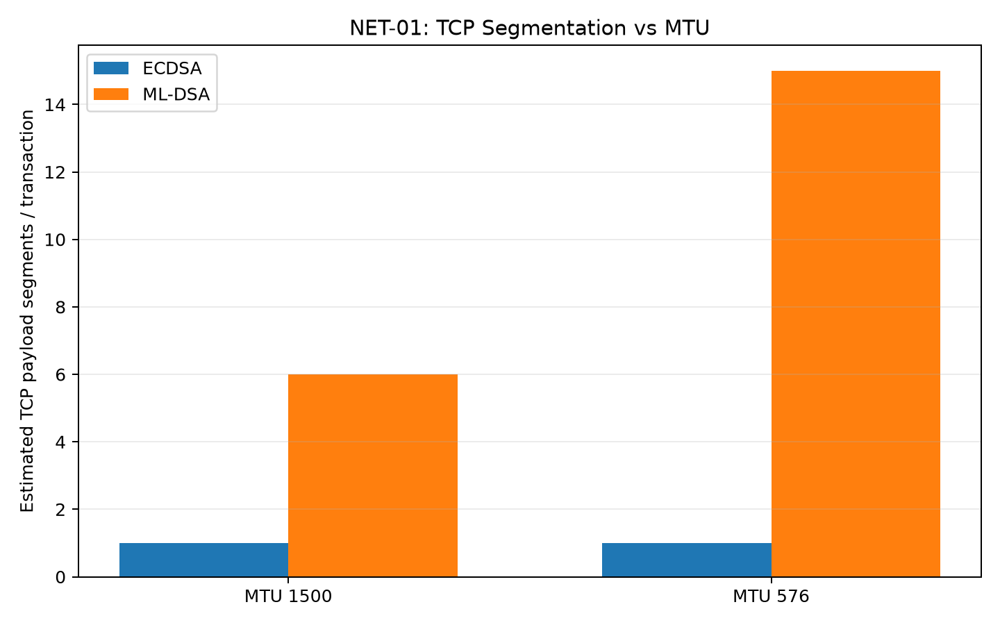
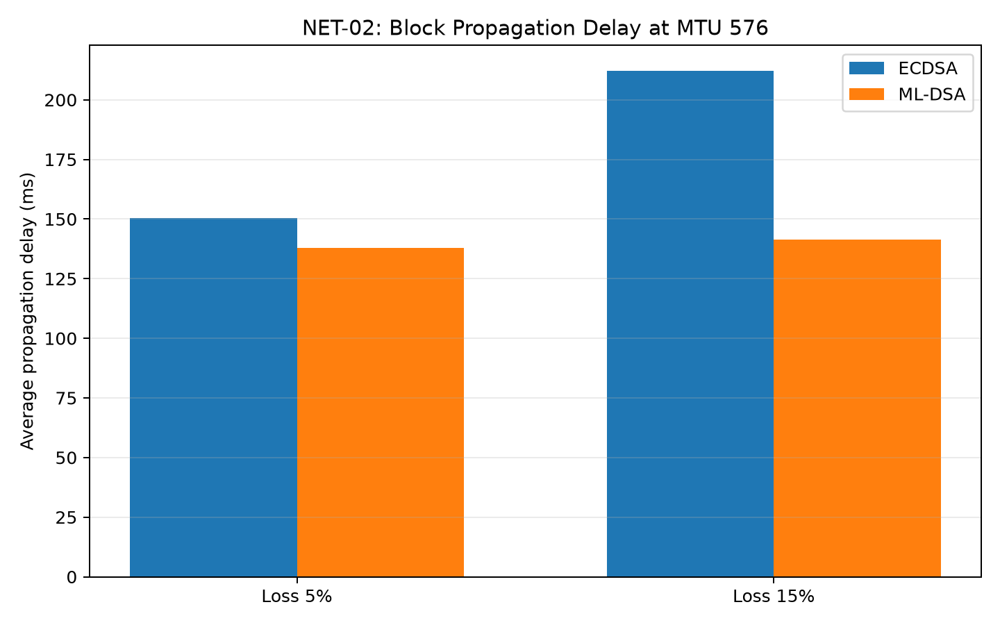
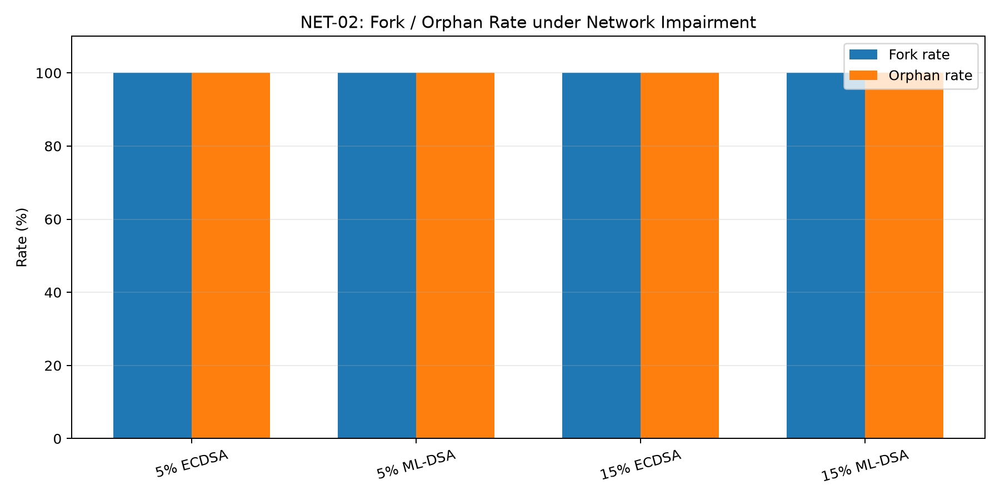

# NET-01 / NET-02 Network Experiment Report

**Sinh viên:** Lê Ngọc Trường Giang  
**Mã sinh viên:** B24DCCE080

## 1. Mục tiêu

NET-01 đánh giá tác động của kích thước giao dịch hậu lượng tử ML-DSA lên TCP segmentation khi MTU giảm từ 1500 byte xuống 576 byte.

NET-02 đánh giá block propagation delay, số lần xử lý `resolve_conflicts()`, fork và orphan block khi Node 1 và Node 2 đào cạnh tranh trong điều kiện mạng có packet loss và delay biến thiên.

## 2. Môi trường thực nghiệm

- Python 3.11
- Blockchain P2P WebSocket TLS chạy trên localhost.
- Node 1 HTTP/P2P: 5000 / 6000.
- Node 2 HTTP/P2P: 5001 / 6001.
- Wireshark bắt traffic trên Npcap Loopback Adapter.
- Windows `netsh` cấu hình Loopback MTU 1500 và 576.
- Clumsy giả lập packet loss 5% và 15%.
- Lag cấu hình 100 ms trên outbound traffic P2P.
- Hai miner được kích hoạt gần đồng thời để tạo điều kiện cạnh tranh block.

## 3. Kích thước chữ ký và transaction

Kích thước ML-DSA-44 đo trực tiếp bằng liboqs:

| Thành phần | Kích thước |
|---|---:|
| ML-DSA public key | 1312 B |
| ML-DSA secret key | 2560 B |
| ML-DSA signature | 2420 B |
| Public key + signature | 3732 B |

Transaction JSON quan sát trong benchmark:

- ECDSA: khoảng **470 B/tx**
- ML-DSA: khoảng **7678 B/tx**
- ML-DSA lớn hơn khoảng **16.34 lần**.

## 4. NET-01 - TCP segmentation và header overhead

Giả sử IPv4 header 20 B và TCP header 20 B:

- MTU 1500 -> MSS xấp xỉ 1460 B.
- MTU 576 -> MSS xấp xỉ 536 B.

| Algorithm | MTU | MSS | Payload | TCP segments | Header bytes | Header overhead / wire |
|---|---:|---:|---:|---:|---:|---:|
| ECDSA | 1500 | 1460 | 470 | 1 | 40 | 7.843% |
| ECDSA | 576 | 536 | 470 | 1 | 40 | 7.843% |
| ML-DSA | 1500 | 1460 | 7678 | 6 | 240 | 3.031% |
| ML-DSA | 576 | 536 | 7678 | 15 | 600 | 7.248% |

### Lưu ý về Wireshark trên Windows Loopback

Raw capture được lưu cục bộ ở:

- `mldsa_mtu1500.pcapng`
- `mldsa_mtu576.pcapng`

Trên Npcap Loopback, Wireshark quan sát một số TCP payload lớn hơn MTU do vị trí capture/offload/coalescing của Windows. Vì vậy số `Displayed` trong capture không được coi trực tiếp là số TCP segment vật lý.

Bảng phía trên sử dụng **payload transaction thực đo** và MSS suy ra từ MTU để tính số TCP payload segment lý thuyết. Capture Wireshark được dùng để xác nhận traffic P2P và payload lớn, không dùng để bịa số segment từ packet đã bị coalesced.

## 5. NET-02 - Propagation delay

### Loss 5%, Lag 100 ms, MTU 576

| Algorithm | Avg delay | Min | Max | Samples |
|---|---:|---:|---:|---:|
| ECDSA | 150.458 ms | 105.800 | 320.477 | 10 |
| ML-DSA | 137.804 ms | 123.399 | 158.749 | 10 |

### Loss 15%, Lag 100 ms, MTU 576

| Algorithm | Avg delay | Min | Max | Samples |
|---|---:|---:|---:|---:|
| ECDSA | 212.202 ms | 105.933 | 886.081 | 10 |
| ML-DSA | 141.532 ms | 109.446 | 215.288 | 10 |

## 6. Fork, orphan và resolve_conflicts()

| Loss | Algorithm | Fork rate | Orphan blocks | resolve_conflicts() |
|---|---|---:|---:|---:|
| 5% | ECDSA | 100.0% | 5 | 10 |
| 5% | ML-DSA | 100.0% | 5 | 10 |
| 15% | ECDSA | 100.0% | 5 | 10 |
| 15% | ML-DSA | 100.0% | 5 | 10 |

Trong kịch bản competitive mining hiện tại, Node 1 và Node 2 được gọi mine gần đồng thời. Do đó fork/orphan đạt trạng thái bão hòa 100% ở cả ECDSA và ML-DSA trong các round mạng suy hao.

Kết quả này **không chứng minh ML-DSA có fork rate cao hơn ECDSA** trong cấu hình hiện tại. Nó chứng minh cơ chế instrumentation phát hiện được fork, orphan và `resolve_conflicts()`, đồng thời cho thấy mạng có delay/loss mở rộng cửa sổ cạnh tranh block.

## 7. Kết luận

1. ML-DSA tạo transaction lớn hơn ECDSA rất nhiều trong cùng hệ thống.
2. Khi MTU giảm từ 1500 xuống 576, số TCP payload segment lý thuyết của ML-DSA tăng đáng kể và tỷ lệ header overhead tăng theo.
3. Packet loss và lag làm block propagation delay tăng mạnh so với baseline localhost.
4. Cơ chế đo đã ghi nhận được fork candidate, orphan block và số lần gọi `resolve_conflicts()`.
5. Trong bài test competitive mining 5 round/case, fork/orphan bão hòa ở 100% cho cả hai thuật toán; vì vậy không được diễn giải dữ liệu hiện tại thành bằng chứng ML-DSA có fork rate cao hơn ECDSA.
6. Để định lượng xác suất fork khác biệt giữa hai thuật toán chính xác hơn, cần random hóa thời điểm mining hoặc chạy nhiều round mà không ép hai miner mine đồng thời tuyệt đối.

## 8. File kết quả

- `benchmarks/results/net01_net02_results.csv`
- `benchmarks/results/net01_net02_summary.csv`
- `benchmarks/results/net01_tcp_segmentation.csv`
- `benchmarks/results/tcp_segmentation_mtu.png`
- `benchmarks/results/propagation_delay.png`
- `benchmarks/results/fork_orphan_rate.png`

Raw `.pcapng` được giữ local làm evidence và không bắt buộc commit vào Git.
