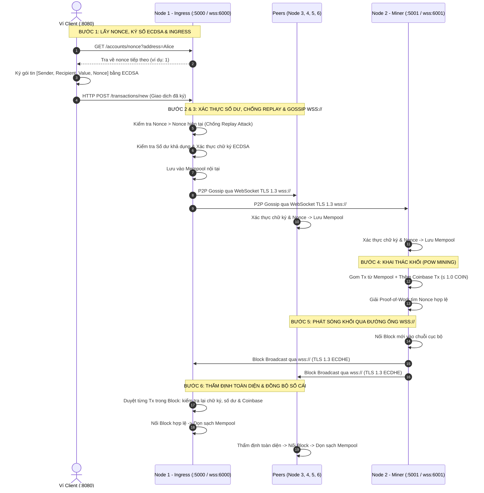

# Blockchain Python P2P Network (Modular Architecture, WebSocket TLS 1.3 & 6-Node Mesh)

> **Dự án nâng cấp hệ thống Blockchain P2P đa Node:** Tái cấu trúc mã nguồn theo kiến trúc module hóa chuyên nghiệp (Zero-Hardcode), chuẩn hóa chu trình **Vòng đời giao dịch (Transaction Lifecycle)** tự động, nâng cấp tầng giao vận sang **Persistent WebSocket (`wss://`) bảo mật bởi TLS 1.3 ECDHE**, chống tấn công phát lại (Anti-Replay Attack) bằng trường `nonce`, thẩm định toàn diện giao dịch trong khối (Full Block Consensus Verification), hộp đen kiểm toán an ninh thời gian thực (Security Audit Trail), tích hợp **Trình bắt gói tin 3 tầng (Live Packet Inspector)** và bộ đo lường hiệu năng chuyên sâu (Micro & Macro Benchmark).

---

## 1. Cấu Trúc Mã Nguồn (Codebase Structure)

Mã nguồn được phân tách chức năng độc lập theo nguyên tắc **Separation of Concerns (SoC)**, loại bỏ hoàn toàn hardcode:

```text
Blockchain-CSATT/
├── blockchain/
│   ├── core/
│   │   ├── crypto.py              # Thẩm định chữ ký số ECDSA (secp256k1), ML-DSA-44 (PQC), RSA, băm SHA-256
│   │   ├── transaction.py         # Data model giao dịch với trường nonce chống Replay Attack
│   │   ├── block.py               # Data model khối, xác minh Proof-of-Work
│   │   ├── ledger.py              # Quản lý Sổ cái (Ledger), Mempool, Nonce tracking, thẩm định khối tuần tự
│   │   └── audit.py               # Hộp đen kiểm toán an ninh thời gian thực (Security Audit Trail)
│   ├── network/
│   │   ├── p2p.py                 # Mạng Mesh WebSocket song công (wss://), Gossip Tx/Block ngầm liên tục
│   │   └── tls_helper.py          # Quản lý TLS 1.3 Context, tự sinh chứng chỉ X.509 ECDSA/ECDHE
│   ├── consensus/
│   │   └── miner.py               # Thuật toán PoW, Worker đào khối ngầm & broadcast Block mới qua wss://
│   ├── api/
│   │   └── routes.py              # REST API (/status, /transactions, /chain, /accounts/nonce, /packet/inspect)
│   ├── templates/
│   │   ├── index.html             # Dashboard Node với Live Security Audit Trail & Live Sync (2s)
│   │   ├── configure.html         # Trang cấu hình danh sách Peers
│   │   └── visualizer.html        # Giao diện P2P Mesh Visualizer & Trình bắt gói tin 3 tầng (Packet Inspector)
│   ├── static/                    # Vendor CSS, Bootstrap, DataTables
│   ├── config.py                  # Xử lý cấu hình qua CLI Flags và file JSON (Zero-Hardcode)
│   ├── server.py                  # Ghép nối các module, khởi chạy Flask + WebSocket server đa luồng
│   └── blockchain.py              # Entrypoint khởi chạy Node
├── blockchain_client/
│   ├── templates/
│   │   ├── make_transaction.html  # Form chuyển tiền có nạp nhanh ví ECDSA (Alice/Bob/Charlie/Dave) & nonce
│   │   ├── index.html             # Trình tạo ví ngẫu nhiên (Wallet Generator)
│   │   └── view_transactions.html # Xem lịch sử giao dịch
│   └── blockchain_client.py       # Client sinh khóa ECDSA, ký số chuẩn và truy vấn Nonce tự động
├── configs/
│   ├── network_6nodes.json        # File cấu hình mẫu mạng lưới P2P Full-Mesh 6 Node
│   ├── wallets.json               # Bộ 4 ví người dùng cố định chuẩn ECDSA (Alice, Bob, Charlie, Dave)
│   └── wallets_ecdsa.json         # Bản sao lưu cấu hình ví ECDSA
├── benchmarks/
│   ├── micro_benchmark.py         # Đo đạc vi mô: KeyGen, Sign, Verify, Key/Signature Size (RSA vs ECDSA vs ML-DSA)
│   ├── macro_benchmark.py         # Đo đạc vĩ mô: 100 giao dịch chéo ví, TPS, Latency, WebSocket Propagation
│   ├── run_benchmarks.py          # Unified runner chạy tự động toàn bộ benchmark
│   └── results/                   # Thư mục lưu kết quả JSON và CSV của các lần benchmark
├── tests/
│   ├── test_consensus_security.py # Kiểm thử an ninh: Replay attack, Overspending, Fake signature, Coinbase cap
│   └── test_p2p_websocket.py      # Kiểm thử truyền tin qua WebSocket TLS 1.3 ECDHE
├── start_interactive_network.py   # Launcher khởi chạy 6 Node + 1 Client cho tương tác thực tế
├── test_6nodes_simulation.py      # Kịch bản kiểm thử tự động toàn diện mạng 6 Node (chứng minh chặn Replay)
└── README.md
```

---

## 2. Chu Trình Vòng Đời Giao Dịch & Tầng Giao Vận Nâng Cấp

Hệ thống phân tách rành mạch hai tầng giao vận để tối ưu tính bảo mật và hiệu năng:
* **Client $\leftrightarrow$ Node (HTTP REST Port 8080 / 5000):** Giữ nguyên chuẩn Web RESTful thân thiện cho ứng dụng ví người dùng truy vấn số dư, lấy số thứ tự `nonce` và gửi giao dịch.
* **Node $\leftrightarrow$ Node (Persistent WebSocket `wss://` Ports 6000-6005):** Thay thế toàn bộ HTTP POST rời rạc bằng đường ống WebSocket duy trì liên tục (Persistent Full-Duplex Mesh), mã hóa bảo vệ toàn bộ lưu lượng bằng **TLS 1.3 ECDHE**.



---

## 3. Các Cải Tiến An Ninh Cốt Lõi (Consensus & Security Hardening)

### 3.1. Chống Tấn Công Phát Lại (Anti-Replay Attack Protection)
- Mỗi tài khoản ví được gán một số thứ tự giao dịch tuần tự (`nonce`).
- Khi tạo giao dịch, Client truy vấn `/accounts/nonce` và đưa `nonce` vào nội dung cần ký.
- Nếu kẻ tấn công nghe lén và gửi lại gói tin cũ, Node lập tức phát hiện `nonce <= current_nonce` hoặc giao dịch đã tồn tại trong Sổ cái, trả về **HTTP 406 Not Acceptable** và ghi log cảnh báo an ninh.

### 3.2. Thẩm Định Toàn Diện Giao Dịch Trong Khối (Full Block Verification)
- Khi nhận khối mới qua P2P (`/p2p/blocks/receive` hoặc qua WebSocket frame), Node không chỉ kiểm tra `previous_hash` và PoW `nonce` mà duyệt qua toàn bộ mảng giao dịch:
  1. **Coinbase Transaction:** Phải có địa chỉ gửi là `THE BLOCKCHAIN` và giá trị thưởng $\le 1.0\text{ COIN}$.
  2. **User Transactions:** Xác thực chữ ký số mật mã (ECDSA / ML-DSA), kiểm tra `nonce` tuần tự và số dư tài khoản khả dụng. Khối chứa giao dịch chi tiêu vượt số dư hoặc chữ ký sai sẽ bị từ chối nối chuỗi ngay lập tức.

### 3.3. Đường Ống WebSocket TLS 1.3 ECDHE Song Công
- Chuyển đổi từ mô hình HTTP POST kết nối ngắn (ngốn chi phí TCP handshake và socket allocation) sang **Persistent WebSocket Mesh**:
  - Cổng kết nối P2P chuyên dụng: `Port Node + 1000` (ví dụ: Node 5000 lắng nghe P2P tại `wss://127.0.0.1:6000`).
  - Tự động sinh cặp khóa và chứng chỉ X.509 ECDSA/ECDHE (`prime256v1`), bọc TLS 1.3 với bộ mã hóa hiện đại `TLS_AES_256_GCM_SHA384`.
  - Giảm độ trễ lan truyền khối tự nhiên xuống còn **~0.279 giây**.

---

## 4. Trình Phân Tích Gói Tin 3 Tầng (Live Packet Inspector)

Trực quan hóa và bóc tách toàn bộ gói tin qua 3 tầng dữ liệu ngay trên giao diện [`visualizer.html`](http://localhost:5000/visualizer) mà **không cần cài đặt Wireshark**:

* **Tab 1: 🌐 Tầng 1: P2P Broadcast JSON (Application Layer)**
  * Dữ liệu JSON nguyên bản sau khi giải mã: `sender_address`, `recipient_address`, `value`, `nonce`, `timestamp`, `signature`.
  * Đo đạc kích thước Payload thực tế (~310 - 330 bytes đối với ECDSA).
* **Tab 2: 🔒 Tầng 2: Bọc TLS 1.3 ECDHE Wire Record (Wireshark-Style Hex Dump)**
  * Socket tap nội tại bắt trực tiếp các byte nhị phân truyền trên đường ống `wss://`.
  * Bóc tách cấu trúc RFC 8446:
    * **Record Header (5 bytes):** `17 03 03 [len_hi] [len_lo]` (0x17 = Application Data).
    * **Encrypted Payload:** Bản mã bảo vệ bằng AES-256-GCM.
    * **Authentication Tag (16 bytes):** Chống giả mạo và bảo vệ toàn vẹn.
  * Hiển thị bảng **Wireshark Hex Dump** chuẩn định dạng: `Offset | Hex Bytes | ASCII Representation`.
* **Tab 3: 🧱 Tầng 3: Khối & Hash Commit (SHA-256)**
  * Hiển thị cấu trúc tiền ảnh chuẩn hóa (**Canonical Block Pre-image**) gồm Coinbase Tx + User Tx.
  * Mã băm **Block Hash (SHA-256)** bất biến niêm phong khối sau khi giải PoW.

---

## 5. Hướng Dẫn Vận Hành & Trải Nghiệm Thực Tế

### 5.1. Khởi Động Mạng Lưới (1-Click)
Mở PowerShell và chạy lệnh:
```powershell
py -3.12 start_interactive_network.py
```
Toàn bộ 6 Node P2P Mesh (kèm máy chủ WebSocket wss://) và 1 Client ví sẽ được kích hoạt ngầm.

### 5.2. Trải Nghiệm Qua Trình Duyệt
1. **Ví Client:** [`http://localhost:8080/make/transaction`](http://localhost:8080/make/transaction)  
   * Đã có sẵn 4 ví mẫu ECDSA: Alice, Bob, Charlie, Dave.  
   * Tự động điền Public/Private Key, lấy `nonce` mới nhất và tạo chữ ký ECDSA.
2. **Dashboard Node 1 (Ingress):** [`http://localhost:5000`](http://localhost:5000)  
   * Xem Live Mempool và Hộp đen kiểm toán `[CRYPTO]` `[P2P]`.
3. **P2P Visualizer & Packet Inspector:** [`http://localhost:5000/visualizer`](http://localhost:5000/visualizer)  
   * Bấm nút tím **`🔬 Bắt Gói Tin Mẫu (Packet Inspector)`** để mở bảng phân tích 3 tầng.
   * Bấm **`⛏️ Khai Thác Node 2 (Mine)`** để kích hoạt Miner đóng khối.

---

## 6. Chạy Kiểm Thử Tự Động (Automated Test Suites)

Hệ thống đi kèm bộ kiểm thử đơn vị và kiểm thử tích hợp toàn diện:

```powershell
# 1. Kiểm thử an ninh đồng thuận, số dư & chống Replay Attack (6 tests)
py -3.12 -m unittest tests/test_consensus_security.py

# 2. Kiểm thử truyền tin P2P qua đường ống WebSocket TLS 1.3 ECDHE (2 tests)
py -3.12 -m unittest tests/test_p2p_websocket.py

# 3. Kịch bản kiểm thử toàn trình 6 Node với chứng minh chặn Replay Attack (HTTP 406)
py -3.12 test_6nodes_simulation.py
```

---

## 7. Kết Quả Đo Lường Hiệu Năng (Benchmark Results)

### 7.1. Micro-Benchmark: So Sánh 3 Thế Hệ Mật Mã Số
Chạy đo lường bằng lệnh: `py -3.12 benchmarks/micro_benchmark.py -n 1000`

| Thuật toán | Cơ chế toán học | Kháng Lượng Tử | KeyGen | Sign | Verify | Public Key | Signature | Khối 1.000 txs | Crypto TPS |
| :--- | :--- | :---: | :---: | :---: | :---: | :---: | :---: | :---: | :---: |
| **RSA-2048** | Phân tích thừa số nguyên | ❌ Không | 66.48 ms | 1.56 ms | **0.09 ms** | 270 B | 256 B | ~758 KB | ~11.751 tx/s |
| **ECDSA (secp256k1)** | Đường cong Elliptic | ❌ Không | 0.72 ms | 0.78 ms | 0.66 ms | **33 B** | **64 B** | **~339 KB** | ~1.517 tx/s |
| **ML-DSA-44** | Mạng tinh thể (Module-LWE) | ✅ **FIPS 204** | **0.29 ms** | **0.69 ms** | 0.15 ms | 1.312 B | 2.420 B | ~3.89 MB | **~6.464 tx/s** |

### 7.2. Macro-Benchmark: Mạng Lưới 6 Node E2E (100 Giao Dịch Chéo Ví & wss://)
Chạy đo lường bằng lệnh: `py -3.12 benchmarks/macro_benchmark.py -n 100`

| Chỉ số đo lường thực nghiệm | Kết quả thực tế (ECDSA + TLS ECDHE) | Nhận xét chuyên môn |
| :--- | :---: | :--- |
| **Tỷ lệ tiếp nhận (Success Rate)** | **100% (100/100 txs)** | Cả 100 giao dịch chéo ngẫu nhiên giữa 4 ví được thẩm định và xếp Mempool hoàn hảo |
| **E2E Ingestion TPS** | **81.58 tx/s** | Thông lượng tiếp nhận, tính toán Nonce và xác thực chữ ký ECDSA |
| **Độ trễ trung bình (Mean Latency)** | **12.23 ms** (Median: 7.77 ms) | Tối ưu hóa nhờ đường ống WebSocket mở sẵn |
| **Đồng bộ khối P2P (Block Propagation)** | **0.279 s** (100% 6 Nodes) | Thời gian lan truyền tự nhiên qua đường ống WebSocket wss:// |
| **Kích thước khối đóng gói (Block Wire Size)** | **2.88 KB** (~295 bytes/tx) | Gọn gàng hơn đáng kể so với PQC (~50 KB), giảm tải lưu trữ sổ cái |

---

## 8. Danh Mục Các API RESTful

| Endpoint | Method | Chức năng |
| :--- | :---: | :--- |
| `/status` | `GET` | Lấy thông tin Node: port, role, mempool_count, chain_length, danh sách peers. |
| `/accounts/nonce` | `GET` | Lấy số thứ tự giao dịch (`nonce`) tiếp theo của một địa chỉ ví. |
| `/transactions/new` | `POST` | Tiếp nhận giao dịch từ Client, kiểm tra số dư/nonce/chữ ký và Gossip P2P. |
| `/transactions/get` | `GET` | Lấy danh sách giao dịch đang chờ trong Mempool. |
| `/chain` | `GET` | Lấy toàn bộ lịch sử Sổ Cái Chuỗi Khối. |
| `/mine` | `GET` | Kích hoạt đào khối và phát sóng Block mới qua WebSocket. |
| `/p2p/transactions/receive`| `POST` | Tiếp nhận giao dịch P2P qua HTTP fallback. |
| `/p2p/blocks/receive` | `POST` | Tiếp nhận Block mới qua HTTP fallback. |
| `/packet/inspect` | `GET` | Bắt gói tin mẫu 3 tầng: JSON, TLS 1.3 Hex Dump và Block Hash Commit. |
| `/audit/logs` | `GET` | Lấy lịch sử Hộp Đen Kiểm Toán An Ninh thời gian thực. |
| `/wallets/sample` | `GET` | Lấy danh sách 4 ví mẫu ECDSA (Alice, Bob, Charlie, Dave). |
| `/visualizer` | `GET` | Mở giao diện P2P Mesh Visualizer & Live Packet Inspector. |