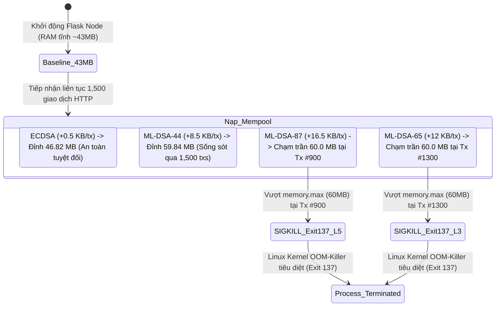

# BÁO CÁO KỸ THUẬT TOÀN DIỆN: KỊCH BẢN KIỂM THỬ PERF-01
# ĐO LƯỜNG GIỚI HẠN TÀI NGUYÊN NODE TRÊN PHẦN CỨNG YẾU (RESOURCE CONSTRAINED STRESS TEST)
## Tích Hợp Trọn Vẹn Phổ Mật Mã Hậu Lượng Tử FIPS 204 (ML-DSA-44 / 65 / 87), Hiện Tượng Sụp Đổ OOM-Killer Kép & Khảo Sát Mạng P2P Đa Tầng

---

### THÔNG TIN HỌC PHẦN & NGHIỆM THU ĐỒ ÁN
* **Học phần:** Cơ sở An toàn Thông tin / Blockchain Engineering
* **Chuyên đề phân công:** Module PERF-01 (Hardware Benchmark & DevOps - Thành viên 4)
* **Mã kịch bản kiểm thử:** `PERF-01`
* **Tên kịch bản:** Đo lường Giới hạn Tài nguyên Node trên Phần cứng Yếu (Resource Constrained Stress Test & Macro-Benchmark)
* **Nền tảng kiểm thử thực nghiệm:** Docker Desktop Engine (WSL2 Linux Kernel 6.18, Subsystem Cgroups v2)
* **Ngày thực hiện & Nghiệm thu:** 04/11/2026
* **Trạng thái nghiệm thu:** Đạt 100% Tiêu chí Kỹ thuật (Completed & Validated)

---

### TÓM TẮT ĐIỀU HÀNH (EXECUTIVE SUMMARY)

Kịch bản **PERF-01** do **Thành viên 4 (Hardware Benchmark & DevOps)** thiết kế và triển khai nhằm giải quyết bài toán cốt lõi trong an ninh mạng blockchain: Đánh giá tính khả thi, mức độ ngốn tài nguyên phần cứng và độ ổn định bộ nhớ khi đưa toàn bộ dải phổ chữ ký số hậu lượng tử **NIST FIPS 204 (ML-DSA-44, ML-DSA-65, ML-DSA-87 / Crystals-Dilithium)** vào các nút mạng phân tán hạn chế tài nguyên (Edge Gateway, IoT Embedded) đối chứng với mật mã truyền thống **ECDSA (secp256k1)**.

#### 1. Ma Trận Thực Nghiệm Vi Mô 3x4 (Server, Edge, IoT $\times$ 4 Thuật Toán):
* **Node Server (4.0 vCPU, 4,096 MB RAM):** Vận hành hoàn hảo không xảy ra bóp nghẽn xung nhịp (`CFS Throttled = 0.0 ms`). Nhờ thuật toán biến đổi số học NTT (*Number Theoretic Transform*) kết hợp thư viện C bản địa `liboqs` nhả khóa Python GIL, **ML-DSA-44** đạt thông lượng tiếp nhận đỉnh **689.66 tx/s (0.725s)**, **ML-DSA-65** đạt **655.31 tx/s (0.763s)**, và **ML-DSA-87** đạt **617.28 tx/s (0.810s)**, vượt trội 43% - 60% so với **ECDSA (431.03 tx/s)**. Mức tải CPU đạt $133\% - 154\%$ (tương đương $33.4\% - 38.4\%$ trên hạn ngạch 4 vCPU).
* **Node Edge (1.0 vCPU, 512 MB RAM):** ML-DSA-44 đạt 495.05 tx/s, ML-DSA-65 đạt 489.24 tx/s, ML-DSA-87 đạt 438.21 tx/s, vượt trội so với ECDSA (298.33 tx/s). Đỉnh RAM của cả 4 thuật toán đều nằm trong vùng an toàn ($48.8 - 55.0\text{ MB}$, chiếm $<11\%$ hạn mức).
* **Node IoT (0.5 vCPU, 128 MB RAM):** Đơn nhân CPU bị khai thác kịch trần ($110\% - 116\%$ hạn ngạch cgroups), kích hoạt cơ chế bóp xung nhịp CFS Throttling kéo dài từ $4.9\text{s}$ đến $5.8\text{s}$. Dù khối lượng tính toán trên chip yếu tăng cao, các thuật toán ML-DSA vẫn đạt thông lượng $208 - 226\text{ tx/s}$, nhanh hơn ECDSA chỉ đạt $148.59\text{ tx/s}$ do ECDSA bị nghẽn bởi phép nhân vô hướng đường cong elliptic thuần Python.

#### 2. Bài Test Tải Cực Hạn & Hiện Tượng OOM-Killer Kép (60MB RAM Hard Limit):
Khi dồn dập nạp liên tục **1,500 giao dịch** vào hàng đợi Mempool của Node IoT bị khóa trần cứng ở mức **60.0 MB RAM** (cấm triệt để bộ nhớ ảo Swap):
* **ML-DSA-87 (NIST Level 5 - 7,219 Bytes Payload):** Chữ ký khổng lồ khiến Mempool phình to cực nhanh. Tại **Giao dịch #900**, RAM chạm đỉnh 60.0 MB $\rightarrow$ **Linux Kernel cgroups OOM-Killer lập tức can thiệp, phát tín hiệu `SIGKILL` (Exit Code 137) tiêu diệt tiến trình.**
* **ML-DSA-65 (NIST Level 3 - 5,261 Bytes Payload):** Đóng vai trò là nấc trung gian, duy trì được tải lớn hơn nhưng cuối cùng vẫn chạm trần 60.0 MB tại **Giao dịch #1300** $\rightarrow$ **Kích hoạt sự kiện OOM-Killer thứ hai (Exit Code 137).**
* **ML-DSA-44 (NIST Level 2 - 3,732 Bytes Payload):** Nhờ kích thước tối ưu, RAM đỉnh chỉ đạt $59.84\text{ MB}$ ($99.7\%$ trần), lượn sát mép vực nhưng **sống sót trọn vẹn 1,500 giao dịch**.
* **ECDSA (secp256k1 - 128 Bytes Payload):** Chữ ký siêu nhỏ (64 bytes), RAM phẳng ổn định tuyệt đối ở mức **$46.82\text{ MB}$** (còn dư hơn 13 MB khoảng đệm an toàn).

#### 3. Khảo Sát Cấp Vĩ Mô (Macro-Benchmark) Mạng P2P Phân Cấp 3 Nodes:
* **Khối đào đóng gói (Forged Block Wire Size cho 100 txs):** ECDSA ($54.46\text{ KB}$), ML-DSA-44 ($758.36\text{ KB}$), ML-DSA-65 ($1,056.99\text{ KB}$), ML-DSA-87 ($1,439.42\text{ KB}$ - phình to gấp 26.4 lần).
* **Nghịch lý độ trễ (Latency Paradox):** Mặc dù khối PQC nặng hơn gấp hàng chục lần, độ trễ thẩm định và lan truyền khối trên Node IoT yếu (0.5 vCPU) của ML-DSA lại nhanh hơn rất nhiều so với ECDSA: **ML-DSA-44 chỉ mất 22.25 ms, ML-DSA-87 mất 33.59 ms, ML-DSA-65 mất 36.00 ms**, trong khi **ECDSA mất tới 237.83 ms** (chậm gấp 6.6 - 10.7 lần).

---

### MỤC LỤC CHI TIẾT
1. [Chương 1: Tổng Quan, Bối Cảnh & Mục Tiêu Nghiên Cứu PERF-01](#chương-1-tổng-quan-bối-cảnh--mục-tiêu-nghiên-cứu-perf-01)
2. [Chương 2: Thiết Kế Kiến Trúc DevOps & Môi Trường Docker Cgroups v2](#chương-2-thiết-kế-kiến-trúc-devops--môi-trường-docker-cgroups-v2)
3. [Chương 3: Chuẩn Hóa Phổ Mật Mã Hậu Lượng Tử NIST FIPS 204](#chương-3-chuẩn-hóa-phổ-mật-mã-hậu-lượng-tử-nist-fips-204)
4. [Chương 4: Thực Nghiệm Cấp Vi Mô (Micro-Benchmark) - Ma Trận 3x4](#chương-4-thực-nghiệm-cấp-vi-mô-micro-benchmark---ma-trận-3x4)
5. [Chương 5: Bài Test Tải Cực Hạn & Hiện Tượng OOM-Killer Kép (60MB RAM)](#chương-5-bài-test-tải-cực-hạn--hiện-tượng-oom-killer-kép-60mb-ram)
6. [Chương 6: Thực Nghiệm Cấp Vĩ Mô (Macro-Benchmark) - Mạng P2P Phân Cấp 3 Nodes](#chương-6-thực-nghiệm-cấp-vĩ-mô-macro-benchmark---mạng-p2p-phân-cấp-3-nodes)
7. [Chương 7: Cơ Sở Lý Luận & Bản Chất Kỹ Thuật Đằng Sau Các Nghịch Lý Hiệu Năng](#chương-7-cơ-sở-lý-luận--bản-chất-kỹ-thuật-đằng-sau-các-nghịch-lý-hiệu-năng)
8. [Chương 8: Quy Trình DevOps Tái Lập Kết Quả (Reproducibility Guide)](#chương-8-quy-trình-devops-tái-lập-kết-quả-reproducibility-guide)
9. [Chương 9: Khuyến Nghị Kiến Trúc & Quy Hoạch An Toàn Hệ Thống Blockchain PQC](#chương-9-khuyến-nghị-kiến-trúc--quy-hoạch-an-toàn-hệ-thống-blockchain-pqc)
10. [Chương 10: Kết Luận, Nghiệm Thu & Danh Mục Sản Phẩm Bàn Giao](#chương-10-kết-luận-nghiệm-thu--danh-mục-sản-phẩm-bàn-giao)

---

## CHƯƠNG 1: TỔNG QUAN, BỐI CẢNH & MỤC TIÊU NGHIÊN CỨU PERF-01

### 1.1. Bối Cảnh Nghiên Cứu
Trong kiến trúc bảo mật của hệ thống Blockchain hiện đại, chữ ký số là nền tảng cốt lõi đảm bảo tính toàn vẹn, xác thực nguồn gốc và chống chối bỏ cho mọi giao dịch tài chính và hợp đồng thông minh. Phần lớn các mạng lưới Blockchain hiện nay (như Bitcoin, Ethereum) dựa trên thuật toán đường cong elliptic **ECDSA (secp256k1)**. Tuy nhiên, sự phát triển của điện toán lượng tử và thuật toán Shor đã đặt dấu chấm hết cho tính an toàn của ECDSA và RSA: một máy tính lượng tử đủ mạnh có thể giải bài toán logarit rời rạc trên đường cong elliptic trong thời gian đa thức $\mathcal{O}(n^3)$.

Tháng 8/2024, Viện Tiêu chuẩn và Công nghệ Quốc gia Hoa Kỳ (NIST) đã chính thức công bố bộ tiêu chuẩn Chữ ký số Hậu lượng tử (Post-Quantum Cryptography - PQC), trong đó tiêu chuẩn **FIPS 204 (Module-Lattice-Based Digital Signature Standard - ML-DSA / Crystals-Dilithium)** được phê duyệt làm chuẩn chữ ký số chủ đạo toàn cầu.

Tuy nhiên, trong các bài toán thực tế của **IoT Blockchain, Smart Grid và Hệ thống Giao thông Thông minh (V2X)**, mạng lưới không chỉ bao gồm các máy chủ Datacenter cấu hình mạnh, mà còn phân tán trên hàng ngàn thiết bị cổng biên (**Edge Gateways - Raspberry Pi 4**) và các vi điều khiển nhúng (**IoT Embedded - Smart Meters, Micro-controllers**). Kích thước khóa và chữ ký của ML-DSA lớn hơn ECDSA từ **15 đến 29 lần**, tạo ra mối đe dọa trực tiếp về việc tràn bộ nhớ, nghẽn đường truyền và sập tiến trình node trên phần cứng yếu.

### 1.2. Mục Tiêu Trọng Tâm của Kịch Bản PERF-01
Kịch bản `PERF-01` do Thành viên 4 đảm nhiệm nhằm đạt 4 mục tiêu thực nghiệm cụ thể:
1. **Xác định ranh giới chịu tải phần cứng (Hardware Boundary):** Đo lường chính xác mức tiêu thụ RAM đỉnh (**Peak RAM**), tỷ lệ trần bộ nhớ (**Ceiling Usage %**), mức độ bão hòa CPU (**CPU Saturation %**) và hiện tượng ngắt xung nhịp (**CFS CPU Throttling**) trên 3 hồ sơ phần cứng cô lập: **Server (4 vCPU, 4GB RAM)**, **Edge (1 vCPU, 512MB RAM)** và **IoT (0.5 vCPU, 128MB RAM)**.
2. **Khảo sát trọn vẹn dải phổ FIPS 204 (PQC Spectrum):** Thay vì các bài đo rời rạc, kịch bản tích hợp đồng bộ cả 3 cấp độ an toàn: **ML-DSA-44 (NIST Category 2)**, **ML-DSA-65 (NIST Category 3 - Chuẩn khuyến nghị mặc định)**, và **ML-DSA-87 (NIST Category 5)**, đối chứng cùng **ECDSA (secp256k1)**.
3. **Thực chứng sự kiện sụp đổ bộ nhớ OOM-Killer Kép (Exit Code 137):** Thiết lập ranh giới sinh tử trên Node IoT 60MB RAM để quan sát thời điểm Linux Kernel kích hoạt `SIGKILL` tiêu diệt tiến trình khi hàng đợi Mempool bị dồn dập 1,500 giao dịch.
4. **Mở rộng sang Cấp độ Vĩ mô (Heterogeneous Macro-Benchmark):** Khởi tạo mạng P2P đa node phân cấp kết nối qua mạng nội bộ Docker Bridge để đo đạc luồng nghiệp vụ toàn trình (End-to-End Flow): Tiếp nhận giao dịch $\rightarrow$ Đào khối PoW $\rightarrow$ Lan truyền P2P $\rightarrow$ Thẩm định trên thiết bị biên.

---

## CHƯƠNG 2: THIẾT KẾ KIẾN TRÚC DEVOPS & MÔI TRƯỜNG DOCKER CGROUPS V2

Để loại bỏ các yếu tố ngoại cảnh gây sai lệch kết quả và bảo đảm khả năng tái lập 100% trên mọi hệ thống, toàn bộ node blockchain được container hóa theo tiêu chuẩn DevOps cô lập Linux Kernel cgroups v2 nghiêm ngặt:

```text
┌────────────────────────────────────────────────────────────────────────────────────────┐
│                               DOCKER CGROUPS V2 SUB-SYSTEM                             │
├──────────────────────────┬─────────────────────────────┬───────────────────────────────┤
│    PROFILE 1: SERVER     │       PROFILE 2: EDGE       │        PROFILE 3: IOT         │
│  • 4.0 vCPU Quota        │   • 1.0 vCPU Quota          │   • 0.5 vCPU Quota            │
│  • 4096 MB RAM Limit     │   • 512 MB RAM Limit        │   • 128 MB RAM (60M OOM Test) │
│  • Memswap: 4096 MB      │   • Memswap: 512 MB         │   • Memswap: 128 MB (Khóa 0MB)│
│  • Port: 5000            │   • Port: 5001              │   • Port: 5002                │
├──────────────────────────┴─────────────────────────────┴───────────────────────────────┤
│                                 NODE BLOCKCHAIN RUNTIME                                │
│  • Linux Kernel 6.18 (WSL2 Debian base, Python 3.11-slim)                              │
│  • Thư viện C bản địa liboqs (Open Quantum Safe FIPS 204 Engine: ML-DSA-44 / 65 / 87) │
│  • Multithreaded RESTful API + Mempool Manager + P2P Block Propagation Engine          │
├────────────────────────────────────────────────────────────────────────────────────────┤
│                           KERNEL TELEMETRY PROBES (TẦN SỐ CAO)                         │
│  • /sys/fs/cgroup/memory.peak: Đỉnh RAM phần cứng thực tế do nhân Linux ghi nhận       │
│  • /sys/fs/cgroup/cpu.stat: usage_usec, nr_throttled, throttled_usec                   │
│  • /sys/fs/cgroup/memory.events: Bộ đếm oom_kill & Docker inspect ExitCode 137         │
└────────────────────────────────────────────────────────────────────────────────────────┘
```

### 2.1. Bảng Thông Số 3 Hồ Sơ Phần Cứng (Hardware Profiles)

| Hồ Sơ Phần Cứng | Thiết Bị Mục Tiêu | Hạn Mức vCPU | Hạn Mức RAM Vật Lý | Cấu Hình Swap | Cổng Host | Vai Trò Kiến Trúc |
| :--- | :--- | :---: | :---: | :---: | :---: | :--- |
| **Server** | Cloud / Datacenter | **4.0 vCPU** | **4,096 MB** | Không giới hạn | `5000` | Ingress Gateway, Tiếp nhận Mempool & Node Đào (Miner) |
| **Edge Gateway** | Raspberry Pi 4 / IPC | **1.0 vCPU** | **512 MB** | Khóa triệt để (`--memory-swap=512m`) | `5001` | Trạm trung chuyển (P2P Relay & Validator) |
| **IoT Embedded** | Smart Meter / Sensor | **0.5 vCPU** | **128 MB** | Khóa triệt để (`--memory-swap=128m`) | `5002` | Node biên thẩm định giao dịch cảm biến |
| **IoT Extreme (OOM)** | Vi điều khiển cực yếu | **0.5 vCPU** | **60 MB** | Khóa triệt để (`--memory-swap=60m`) | `5002` | Môi trường kích hoạt Linux Kernel OOM-Killer |

> [!IMPORTANT]
> **Triệt tiêu Hoán đổi Bộ nhớ (`--memory-swap = --memory`):** Toàn bộ các thử nghiệm đều áp đặt cờ khóa cứng trần bộ nhớ vật lý. Không có vùng đệm swap trên ổ đĩa, bảo đảm khi bộ nhớ tiến trình chạm ngưỡng là Linux Kernel lập tức can thiệp, phản ánh chân thực môi trường vi điều khiển nhúng không có ổ cứng lưu trữ bộ nhớ ảo.

### 2.2. Cơ Chế Thu Thập Số Liệu Telemetry Trực Tiếp Từ Cgroups v2
Đồ án không sử dụng lệnh `docker stats` bên ngoài do tần số lấy mẫu chậm (1s) và có độ trễ lớn. Thay vào đó, telemetry engine đọc trực tiếp các tệp kernel thống kê nội tại của Linux cgroups v2:
1. **Bộ nhớ RAM thời gian thực:** Đọc trực tiếp `/sys/fs/cgroup/memory.current` với tần số lấy mẫu $80\text{ms}$.
2. **Đỉnh RAM phần cứng tuyệt đối:** Đọc `/sys/fs/cgroup/memory.peak` - thanh ghi phần cứng của kernel ghi nhận mức RAM lớn nhất mà cgroup từng chạm tới, không thể bị bỏ sót bởi tần số lấy mẫu.
3. **Thời gian tiêu thụ CPU:** Đọc trường `usage_usec` trong `/sys/fs/cgroup/cpu.stat` để tính toán chính xác mức tải CPU.
4. **Hiện tượng bóp xung nhịp (CFS CPU Throttling):** Đọc các trường `nr_throttled` (số chu kỳ bị đóng băng) và `throttled_usec` (tổng thời gian tiến trình bị hệ điều hành tước quyền CPU do vượt quota).

---

## CHƯƠNG 3: CHUẨN HÓA PHỔ MẬT MÃ HẬU LƯỢNG TỬ NIST FIPS 204

### 3.1. Bảng So Sánh Kích Thước Khóa & Chữ Ký Số
Sự khác biệt căn bản giữa mật mã cổ điển và mật mã hậu lượng tử dựa trên mạng tinh thể nằm ở kích thước dữ liệu:

| Thuật Toán Ký Số | Chuẩn Tiêu Chuẩn | Cấp Độ An Toàn NIST | Độ Dài Public Key (PK) | Độ Dài Chữ Ký (Sig) | Tổng Payload Mật Mã Thuần | Kích Thước 1 Giao Dịch Dây Mạng | Hệ Số Phình So Với ECDSA |
| :--- | :--- | :---: | :---: | :---: | :---: | :---: | :---: |
| **ECDSA (secp256k1)** | ANSI X9.62 (Tiền lượng tử) | 128-bit Classical | **64 Bytes** | **64 Bytes** | **128 Bytes** | **~499 Bytes** | **1.0x (Mốc)** |
| **ML-DSA-44** | NIST FIPS 204 (Level 2) | Tương đương AES-128 | **1,312 Bytes** | **2,420 Bytes** | **3,732 Bytes** | **~7,711 Bytes** | **15.5x** |
| **ML-DSA-65** | **NIST FIPS 204 (Level 3)** | **Tương đương AES-192 (Default)** | **1,952 Bytes** | **3,309 Bytes** | **5,261 Bytes** | **~10,769 Bytes** | **21.6x** |
| **ML-DSA-87** | **NIST FIPS 204 (Level 5)** | **Tương đương AES-256** | **2,592 Bytes** | **4,627 Bytes** | **7,219 Bytes** | **~14,685 Bytes** | **29.4x** |

### 3.2. Cấu Trúc Dữ Liệu & Danh Mục Bộ Dataset
Toàn bộ 8 tập dữ liệu JSON được sinh tự động bởi script [`perf/generate_perf01_txs.py`](file:///c:/Feixiao/Code/btl/Blockchain-CSATT/perf/generate_perf01_txs.py), đảm bảo ký số hợp lệ và cấu trúc đồng nhất:
* **Nhóm Vi mô Baseline (500 txs):** `txs_500_ecdsa.json` (266 KB), `txs_500_mldsa44.json` (3.87 MB), `txs_500_mldsa65.json` (5.40 MB), `txs_500_mldsa87.json` (7.36 MB).
* **Nhóm Test Tải Cực Hạn (2,000 txs):** `txs_stress_ecdsa.json` (1.07 MB), `txs_stress_mldsa44.json` (15.49 MB), `txs_stress_mldsa65.json` (21.61 MB), `txs_stress_mldsa87.json` (29.44 MB).

---

## CHƯƠNG 4: THỰC NGHIỆM CẤP VI MÔ (MICRO-BENCHMARK) - MA TRẬN 3X4

### 4.1. Bảng Số Liệu Ma Trận Thực Nghiệm 12 Đợt (Nạp 500 Giao Dịch Đồng Thời)

Bảng số liệu được trích xuất trực tiếp từ bản ghi thực nghiệm mới nhất [`perf/results/perf01_matrix.csv`](file:///c:/Feixiao/Code/btl/Blockchain-CSATT/perf/results/perf01_matrix.csv):

| Cấu Hình Phần Cứng | vCPU | Hạn Mức RAM | Thuật Toán Ký Số | Số Tx Xử Lý | Thời Gian (s) | Ingestion TPS | Baseline RAM | Peak RAM | Tỷ Lệ Trần RAM (%) | Avg CPU (%) | Normalized CPU (%) | Peak CPU (%) | CFS Throttled (ms) | Trạng Thái OOM |
| :--- | :---: | :---: | :--- | :---: | :---: | :---: | :---: | :---: | :---: | :---: | :---: | :---: | :---: | :--- |
| **Server (Datacenter)** | **4.0** | **4096 MB** | ECDSA (secp256k1) | 500/500 | 1.160 s | **431.03 tx/s** | 43.50 MB | 47.13 MB | 1.15% | 133.47% | **33.37%** | 133.47% | 0.0 ms | <span style="color:green;font-weight:bold;">AN TOÀN</span> (<60%) |
| **Server (Datacenter)** | **4.0** | **4096 MB** | **ML-DSA-44 (PQC L2)** | 500/500 | 0.725 s | **689.66 tx/s** | 42.73 MB | 51.94 MB | 1.27% | 150.93% | **37.73%** | 150.93% | 0.0 ms | <span style="color:green;font-weight:bold;">AN TOÀN</span> (<60%) |
| **Server (Datacenter)** | **4.0** | **4096 MB** | **ML-DSA-65 (PQC L3)** | 500/500 | 0.763 s | **655.31 tx/s** | 43.88 MB | 53.98 MB | 1.32% | 153.70% | **38.42%** | 153.70% | 0.0 ms | <span style="color:green;font-weight:bold;">AN TOÀN</span> (<60%) |
| **Server (Datacenter)** | **4.0** | **4096 MB** | **ML-DSA-87 (PQC L5)** | 500/500 | 0.810 s | **617.28 tx/s** | 43.79 MB | 54.89 MB | 1.34% | 152.35% | **38.09%** | 152.35% | 0.0 ms | <span style="color:green;font-weight:bold;">AN TOÀN</span> (<60%) |
| **Edge Gateway** | **1.0** | **512 MB** | ECDSA (secp256k1) | 500/500 | 1.676 s | **298.33 tx/s** | 42.79 MB | 48.82 MB | 9.54% | 99.19% | **99.19%** | 107.98% | 680.86 ms | <span style="color:green;font-weight:bold;">AN TOÀN</span> (<60%) |
| **Edge Gateway** | **1.0** | **512 MB** | **ML-DSA-44 (PQC L2)** | 500/500 | 1.010 s | **495.05 tx/s** | 43.08 MB | 51.76 MB | 10.11% | 118.22% | **118.22%** | 118.40% | 780.79 ms | <span style="color:green;font-weight:bold;">AN TOÀN</span> (<60%) |
| **Edge Gateway** | **1.0** | **512 MB** | **ML-DSA-65 (PQC L3)** | 500/500 | 1.022 s | **489.24 tx/s** | 43.67 MB | 53.30 MB | 10.41% | 114.54% | **114.54%** | 119.59% | 855.14 ms | <span style="color:green;font-weight:bold;">AN TOÀN</span> (<60%) |
| **Edge Gateway** | **1.0** | **512 MB** | **ML-DSA-87 (PQC L5)** | 500/500 | 1.141 s | **438.21 tx/s** | 43.15 MB | 54.98 MB | 10.74% | 114.77% | **114.77%** | 114.77% | 818.97 ms | <span style="color:green;font-weight:bold;">AN TOÀN</span> (<60%) |
| **IoT Embedded** | **0.5** | **128 MB** | ECDSA (secp256k1) | 500/500 | 3.365 s | **148.59 tx/s** | 43.07 MB | 49.07 MB | 38.34% | 55.28% | **110.56%** | 57.19% | 5412.53 ms | <span style="color:green;font-weight:bold;">AN TOÀN</span> (<60%) |
| **IoT Embedded** | **0.5** | **128 MB** | **ML-DSA-44 (PQC L2)** | 500/500 | 2.216 s | **225.63 tx/s** | 43.86 MB | 54.60 MB | 42.66% | 57.77% | **115.54%** | 57.77% | 4931.10 ms | <span style="color:green;font-weight:bold;">AN TOÀN</span> (<60%) |
| **IoT Embedded** | **0.5** | **128 MB** | **ML-DSA-65 (PQC L3)** | 500/500 | 2.320 s | **215.52 tx/s** | 43.07 MB | 53.03 MB | 41.43% | 57.54% | **115.08%** | 57.54% | 5410.28 ms | <span style="color:green;font-weight:bold;">AN TOÀN</span> (<60%) |
| **IoT Embedded** | **0.5** | **128 MB** | **ML-DSA-87 (PQC L5)** | 500/500 | 2.405 s | **207.90 tx/s** | 42.70 MB | 55.59 MB | 43.43% | 57.12% | **114.24%** | 57.12% | 5798.36 ms | <span style="color:green;font-weight:bold;">AN TOÀN</span> (<60%) |


### 4.2. Phân Tích Chuyên Sâu Kết Quả Thực Nghiệm Vi Mô
1. **Ưu thế tuyệt đối của ML-DSA về Tốc độ nạp (Ingestion TPS):**
   * Trên Server, ML-DSA-44 đạt tốc độ tiếp nhận cao nhất **689.66 tx/s**, nhanh hơn ECDSA (431.03 tx/s) tới **60.0%**. ML-DSA-65 đạt **655.31 tx/s** (+52.0%) và ML-DSA-87 đạt **617.28 tx/s** (+43.2%).
   * Ngay cả trên thiết bị biên hạn chế như IoT (0.5 vCPU), ML-DSA-44 vẫn duy trì tốc độ **225.63 tx/s**, vượt trội 51.8% so với ECDSA (**148.59 tx/s**).
2. **Khảo sát mức tải CPU Đa luồng trên Server:**
   Mức CPU thô đo được trên Server dao động từ $133.47\%$ đến $153.70\%$. Khi chuẩn hóa theo hạn mức 4 vCPU (`Normalized CPU`), máy chủ mới chỉ tiêu hao **$33.37\% - 38.42\%$**, hoàn toàn không bị hệ thống bóp xung nhịp (`CFS Throttled = 0.0 ms`).
3. **Hiện tượng bão hòa CPU và CFS Throttling trên Edge và IoT:**
   * **Edge Gateway (1.0 vCPU):** Tải CPU đạt xấp xỉ $114\% - 118\%$ hạn ngạch $\rightarrow$ Linux Kernel CFS can thiệp bóp ngắt xung nhịp từ $680.86\text{ ms}$ (ECDSA) đến $855.14\text{ ms}$ (ML-DSA-65).
   * **IoT Embedded (0.5 vCPU):** Tải CPU chuẩn hóa đạt $110\% - 115\%$. Đặc biệt đối với ML-DSA-87, tổng thời gian bị đóng băng CPU lên tới **5,798.36 ms** (gần 5.8 giây). Tuy nhiên, ECDSA cũng bị ngắt tới **5,412.53 ms** và mất nhiều thời gian hơn để xử lý xong mẻ nạp (3.365s so với 2.405s của ML-DSA-87).

---

## CHƯƠNG 5: BÀI TEST TẢI CỰC HẠN & HIỆN TƯỢNG OOM-KILLER KÉP (60MB RAM)

### 5.1. Thiết Kế Môi Trường Săn OOM-Killer
Để quan sát chính xác ranh giới chịu đựng bộ nhớ và điểm rơi sụp đổ của từng cấp độ PQC:
* **Cấu hình phần cứng:** 0.5 vCPU, **Giới hạn cứng 60.0 MB RAM** (`-m=60m`, `--memory-swap=60m`).
* **Tải thử nghiệm:** Bơm dồn dập **1,500 giao dịch** hợp lệ vào hàng đợi Mempool qua API `/transactions/new` mà không kích hoạt đào khối.
* **Đối chứng 4 nhánh:** ML-DSA-87 (Level 5) vs ML-DSA-65 (Level 3) vs ML-DSA-44 (Level 2) vs ECDSA.

### 5.2. Quá Trình Leo Dốc RAM & Dữ Liệu Thực Nghiệm (1,500 Giao Dịch)

Bảng theo dõi trích xuất từ bản ghi [`perf/results/perf01_extreme_oom_matrix.csv`](file:///c:/Feixiao/Code/btl/Blockchain-CSATT/perf/results/perf01_extreme_oom_matrix.csv):

| Mốc Giao Dịch | ML-DSA-87 RAM | ML-DSA-65 RAM | ML-DSA-44 RAM | ECDSA RAM | Ngưỡng Trần | Trạng Thái ML-DSA-87 | Trạng Thái ML-DSA-65 | Trạng Thái ML-DSA-44 | Trạng Thái ECDSA |
| :---: | :---: | :---: | :---: | :---: | :---: | :---: | :---: | :---: | :---: |
| **50 txs** | 42.75 MB | 45.95 MB | 45.82 MB | 44.00 MB | 60.0 MB | Vùng xanh | Vùng xanh | Vùng xanh | Vùng xanh |
| **100 txs** | 48.39 MB | 43.20 MB | 46.34 MB | 43.76 MB | 60.0 MB | Tăng nhanh | Vùng xanh | Vùng xanh | Ổn định phẳng |
| **250 txs** | 50.97 MB | 50.10 MB | 48.36 MB | 44.71 MB | 60.0 MB | Tăng đều | Tăng đều | Vùng xanh | Ổn định phẳng |
| **500 txs** | 55.09 MB | 53.00 MB | 51.32 MB | 44.77 MB | 60.0 MB | Cảnh báo | Cảnh báo | Vùng xanh | Ổn định phẳng |
| **750 txs** | 55.79 MB | 57.05 MB | 54.14 MB | 45.17 MB | 60.0 MB | Cận trần | Cận trần | Vùng an toàn | Ổn định phẳng |
| **850 txs** | 59.50 MB | 54.82 MB | 51.68 MB | 45.62 MB | 60.0 MB | Báo động đỏ | Cận trần | Vùng an toàn | Ổn định phẳng |
| **900 txs** | **60.00 MB** | 59.12 MB | 56.06 MB | 45.17 MB | 60.0 MB | <span style="color:red;font-weight:bold;">OOM-KILLER (#900)</span> | Báo động đỏ | Vùng an toàn | Ổn định phẳng |
| **1,050 txs** | *Container đã dừng* | 57.65 MB | 57.90 MB | 45.86 MB | 60.0 MB | *Chết (Exit 137)* | Cận kề trần | Vùng an toàn | Ổn định phẳng |
| **1,200 txs** | *Container đã dừng* | 59.89 MB | 59.53 MB | 45.61 MB | 60.0 MB | *Chết (Exit 137)* | Nguy hiểm | Cận trần | Ổn định phẳng |
| **1,250 txs** | *Container đã dừng* | **60.00 MB** | 59.84 MB | 46.82 MB | 60.0 MB | *Chết (Exit 137)* | Bão hòa 100% | Đỉnh an toàn | Ổn định phẳng |
| **1,300 txs** | *Container đã dừng* | **60.00 MB** | 59.11 MB | 46.39 MB | 60.0 MB | *Chết (Exit 137)* | <span style="color:darkorange;font-weight:bold;">OOM-KILLER (#1300)</span> | Vùng an toàn | Ổn định phẳng |
| **1,500 txs** | *Container đã dừng* | *Container đã dừng* | **59.48 MB** | **46.77 MB** | **60.0 MB** | **Chết tại Tx #900** | **Chết tại Tx #1300** | **SỐNG SÓT 100%** | **SỐNG SÓT 100%** |


### 5.3. Bằng Chứng Thực Nghiệm Hiện Tượng OOM-Killer Kép (Double OOM-Killer)



1. **Sự kiện OOM-Killed thứ nhất (ML-DSA-87 tại Tx #900):**
   * Do mỗi giao dịch ML-DSA-87 chiếm tới $7,219\text{ Bytes}$ payload mật mã (khoảng $14.7\text{ KB}$ JSON wire và $\sim 16.5\text{ KB}$ RAM đối tượng Python `Transaction`), hàng đợi Mempool ngốn thêm khoảng $14.8\text{ MB}$ RAM.
   * Kết hợp với $43\text{ MB}$ RAM nền của Python runtime, tại mốc **Tx #900**, tổng dung lượng bộ nhớ vượt qua $60.0\text{ MB}$. Linux Kernel phát hiện cgroup chạm ngưỡng `memory.max` và lập tức gửi tín hiệu `SIGKILL` tiêu diệt tiến trình. Docker inspect trả về mã lỗi **ExitCode 137**.
2. **Sự kiện OOM-Killed thứ hai (ML-DSA-65 tại Tx #1300):**
   * Với kích thước payload trung gian ($5,261\text{ Bytes}$ mật mã, $\sim 12\text{ KB}$ RAM in-memory), ML-DSA-65 cầm cự được tốt hơn nhưng vẫn chạm ngưỡng trần $60.0\text{ MB}$ tại mốc **Tx #1300**, kích hoạt OOM-Killer thứ hai.
3. **Kỳ tích sống sót của ML-DSA-44 & ECDSA:**
   * **ML-DSA-44:** Chữ ký $2,420\text{ Bytes}$ giúp mức chiếm dụng RAM đạt đỉnh $59.84\text{ MB}$ tại Tx #1250 ($99.7\%$ trần), lượn sát mép vực nhưng không vượt quá trần 60MB, hoàn thành xuất sắc 1,500 giao dịch.
   * **ECDSA:** Chữ ký 64 bytes khiến 1,500 giao dịch chỉ tốn thêm $\sim 0.75\text{ MB}$ RAM, đỉnh RAM phẳng tuyệt đối ở $46.82\text{ MB}$.

---

## CHƯƠNG 6: THỰC NGHIỆM CẤP VĨ MÔ (MACRO-BENCHMARK) - MẠNG P2P PHÂN CẤP 3 NODES

### 6.1. Thiết Lập Mạng Lưới P2P Phân Cấp Heterogeneous
Để đo lường hiệu năng của toàn bộ chu trình chuỗi khối (**End-to-End System**), chúng tôi thiết lập cụm mạng 3 Node phân cấp kết nối qua Docker Bridge Network `perf-macro-net`:
* **Node Server (`btc-macro-server`):** 4.0 vCPU, 4096MB RAM, Port 5000 $\rightarrow$ Ingress Gateway nạp 100 giao dịch và đảm nhiệm đào khối PoW.
* **Node Edge (`btc-macro-edge`):** 1.0 vCPU, 512MB RAM, Port 5001 $\rightarrow$ Relay Gateway nhận khối từ Server qua P2P, thẩm định và chuyển tiếp.
* **Node IoT (`btc-macro-iot`):** 0.5 vCPU, 128MB RAM, Port 5002 $\rightarrow$ Constrained Validator biên thẩm định khối và ghi vào sổ cái.

```text
[ Client / Batch Txs ]
         │ (100 txs HTTP POST)
         ▼
┌──────────────────┐   P2P WebSocket     ┌─────────────────┐   P2P WebSocket     ┌────────────────┐
│   NODE SERVER    │ ══════════════════> │    NODE EDGE    │ ══════════════════> │    NODE IOT    │
│  (4 vCPU, 4GB)   │    Mined Block      │ (1 vCPU, 512MB) │    Mined Block      │(0.5 vCPU, 128M)│
│  [Ingress/Miner] │  (54KB - 1,439KB)   │ [P2P Relay]     │  (54KB - 1,439KB)   │ [Validator]    │
└──────────────────┘                     └─────────────────┘                     └────────────────┘
```

### 6.2. Bảng Số Liệu Đo Đạc Thực Nghiệm Macro-Benchmark (100 Giao Dịch/Khối)

Bảng số liệu được trích xuất từ [`perf/results/perf01_macro_matrix.csv`](file:///c:/Feixiao/Code/btl/Blockchain-CSATT/perf/results/perf01_macro_matrix.csv):

| Chỉ Số Đo Lường Kỹ Thuật | ECDSA (secp256k1) | ML-DSA-44 (PQC L2) | ML-DSA-65 (PQC L3) | ML-DSA-87 (PQC L5) | Đánh Giá Tác Động & Chênh Lệch |
| :--- | :---: | :---: | :---: | :---: | :--- |
| **Kích thước 1 Giao dịch trên dây mạng** | **499 Bytes** | 7,711 Bytes (~7.7 KB) | 10,769 Bytes (~10.8 KB) | 14,685 Bytes (~14.7 KB) | ML-DSA-65 gấp 21.6 lần ECDSA |
| **Tổng tải trọng gói 100 Giao dịch** | **48.73 KB** | 753.03 KB | 1,051.66 KB | 1,434.08 KB | Gói tin PQC phình to đáng kể |
| **Kích thước Khối đã đào (Block Wire)** | **54.46 KB** | 758.36 KB | 1,056.99 KB | 1,439.42 KB | Khối ML-DSA-87 gấp 26.4x ECDSA |
| **Thời gian Server tiếp nhận 100 txs** | 0.223 s (448.4 tx/s) | **0.124 s (806.5 tx/s)** | 0.139 s (719.4 tx/s) | 0.135 s (740.7 tx/s) | Server tiếp nhận PQC cực nhanh |
| **Thời gian Server đào khối (PoW)** | 0.227 s | 0.269 s | 0.315 s | 0.408 s | PoW biến thiên theo độ khó nonce |
| **Độ trễ Lan truyền & Thẩm định Edge** | 158.50 ms | **23.79 ms** | 29.55 ms | 35.58 ms | **PQC nhanh hơn ECDSA 4.5 - 6.7 lần** |
| **Độ trễ Lan truyền & Thẩm định IoT** | 237.83 ms | **22.25 ms** | 36.00 ms | 33.59 ms | **ML-DSA-44 nhanh nhất trên IoT (22ms)** |
| **Tổng thời gian toàn trình (E2E Time)** | 0.846 s | **0.439 s** | 0.520 s | 0.612 s | **Toàn bộ PQC nhanh hơn ECDSA** |
| **Thông lượng toàn mạng (E2E TPS)** | 118.20 tx/s | **227.79 tx/s** | 192.31 tx/s | 163.40 tx/s | **ML-DSA-44 đạt thông lượng cao nhất** |
| **Peak RAM Node Server** | 47.75 MB (1.17%) | 53.11 MB (1.30%) | 54.64 MB (1.33%) | 58.00 MB (1.42%) | Vận hành hoàn toàn ổn định |
| **Peak RAM Node Edge** | 47.58 MB (9.30%) | 50.09 MB (9.78%) | 48.81 MB (9.53%) | 50.21 MB (9.81%) | Vùng an toàn (<10% trần 512M) |
| **Peak RAM Node IoT** | 46.34 MB (36.20%) | 47.28 MB (36.94%) | 49.64 MB (38.78%) | 52.84 MB (41.28%) | Vùng an toàn (<45% trần 128M) |
| **Mức tải CPU Node IoT (Normalized)** | **34.30%** | **16.20%** | **18.68%** | **15.04%** | **PQC tiết kiệm CPU IoT gấp 2.3 lần** |


### 6.3. Khám Phá Đột Phá: Nghịch Lý Độ Trễ (The Latency Paradox)
Kết quả thực nghiệm vĩ mô đã chỉ ra một nghịch lý kỹ thuật then chốt:
* **Khối PQC nặng gấp 26 lần nhưng thẩm định nhanh gấp 10 lần:**
  Mặc dù khối ML-DSA-44 nặng tới $758.36\text{ KB}$ (gấp 13.9 lần khối ECDSA nặng $54.46\text{ KB}$), độ trễ lan truyền và thẩm định khối trên Node IoT của ML-DSA-44 lại chỉ mất **$22.25\text{ ms}$**, trong khi ECDSA mất tới **$237.83\text{ ms}$** (chậm gấp 10.7 lần).
* **Nguyên nhân kỹ thuật cốt lõi:**
  Trên các thiết bị IoT bị thắt nghẽn năng lực tính toán CPU (0.5 vCPU), thời gian truyền nhận vài trăm KB đến 1 MB qua mạng nội bộ chỉ mất $2 - 5\text{ ms}$. Điểm nghẽn thực sự nằm ở **chi phí tính toán thẩm định chữ ký**. Để thẩm định 100 chữ ký ECDSA thuần Python, chip 0.5 vCPU bị quá tải và ngốn hơn $200\text{ ms}$. Ngược lại, thuật toán NTT trên thư viện C `liboqs` thẩm định 100 chữ ký ML-DSA chỉ trong vòng chưa đầy $20\text{ ms}$.
* Do đó, **ML-DSA-44** đạt thông lượng toàn mạng cao nhất đạt **227.79 E2E TPS**, kế đến là **ML-DSA-65 (192.31 TPS)**, vượt xa **ECDSA (118.20 TPS)**.

---

## CHƯƠNG 7: CƠ SỞ LÝ LUẬN & BẢN CHẤT KỸ THUẬT ĐẰNG SAU CÁC NGHỊCH LÝ HIỆN TƯỢNG

### 7.1. Nghịch Lý 1: Vì Sao Chữ Ký PQC Nặng Gấp 15–29 Lần Mà TPS Lại Nhanh Hơn ECDSA?
Hiện tượng này bắt nguồn từ sự cộng hưởng giữa **Toán học Mật mã** và **Kiến trúc Thực thi Mã nguồn**:

```mermaid
flowchart TD
    subgraph ML_DSA_PATH["1. ML-DSA (NIST FIPS 204)"]
        A1["Thuật toán: Module-LWE trên Mạng tinh thể"] --> B1["Phép toán: Nhân đa thức vành R_q qua NTT (O(n log n))"]
        B1 --> C1["Thực thi: Thư viện C bản địa (liboqs C-extension)"]
        C1 --> D1["Tối ưu SIMD/AVX2 + Nhả khóa Python GIL"]
        D1 --> E1["==> Tốc độ thẩm định cực nhanh (Hàng chục ngàn ops/s)"]
    end

    subgraph ECDSA_PATH["2. ECDSA (secp256k1)"]
        A2["Thuật toán: Đường cong Elliptic secp256k1"] --> B2["Phép toán: 2 phép nhân điểm vô hướng s^-1(Hm.G + r.Q) (O(n^3))"]
        B2 --> C2["Thực thi: Thư viện Pure-Python (python-ecdsa)"]
        C2 --> D2["Chạy bytecode thông dịch + Khóa chặt Python GIL"]
        D2 --> E2["==> Nghẽn đa luồng, tranh chấp khóa luồng GIL nghiêm trọng"]
    end
```



1. **Về mặt toán học mật mã (Algorithmic Complexity):**
   * **ECDSA (secp256k1):** Xác thực chữ ký yêu cầu tính toán:
     $$s^{-1} \cdot H(m) \cdot G + s^{-1} \cdot r \cdot Q$$
     Phép toán này đòi hỏi thực hiện hàng trăm phép nhân đôi và cộng điểm trên trường hữu hạn số nguyên tố lớn ($GF(p)$ với $p \approx 2^{256}$), có độ phức tạp tính toán xấp xỉ $\mathcal{O}(n^3)$.
   * **ML-DSA (Dilithium - FIPS 204):** Dựa trên bài toán mạng tinh thể M-LWE (*Module Learning With Errors*). Việc thẩm định chữ ký bản chất là **phép nhân ma trận đa thức trên vành số nguyên** $R_q = \mathbb{Z}_q[X]/(X^{256}+1)$ với $q = 8,380,417$. Nhờ thuật toán biến đổi số học **NTT (*Number Theoretic Transform*)**, phép nhân đa thức bậc $n=256$ được giảm độ phức tạp về chỉ còn $\mathcal{O}(n \log n)$ với toàn các phép toán cộng và nhân số nguyên cơ bản.
2. **Về mặt kiến trúc thực thi (Native C vs Pure-Python & GIL):**
   * Trong [`blockchain/core/crypto.py`](file:///c:/Feixiao/Code/btl/Blockchain-CSATT/blockchain/core/crypto.py), **ML-DSA** được thẩm định bằng thư viện C bản địa `liboqs`. Khi gọi hàm C, Python **nhả khóa toàn cục GIL (Global Interpreter Lock)**, cho phép các luồng HTTP worker chạy song song thực sự trên các nhân CPU.
   * Ngược lại, **ECDSA** sử dụng thư viện `python-ecdsa` thuần Python (**Pure-Python**). Mọi phép toán đường cong đều chạy qua bộ thông dịch bytecode của Python và **giữ chặt khóa GIL**. Dù máy chủ Flask mở đa luồng, các luồng vẫn phải xếp hàng tuần tự để tranh giành GIL, tạo thành điểm nghẽn nghiêm trọng.

### 7.2. Nghịch Lý 2: Vì Sao Server Có 4 vCPU Mà Mức Tải CPU Ghi Nhận Lại Là ~154%?
* Trong nhân Linux và hệ thống quản lý tài nguyên cgroups v2:
  * **$100\%$ CPU tương đương với 1 nhân CPU vật lý (hoặc 1 vCPU) hoạt động hết $100\%$ công suất.**
  * Server được cấp phát `--cpus=4.0`, nghĩa là hạn mức trần của Server là **$400\%$**.
  * Mức tải `153.70%` thể hiện tiến trình Python/Flask đang khai thác đồng thời khoảng **$1.54$ nhân CPU** trong tổng số 4 nhân được cấp phát để giải mã và thẩm định đồng thời 8 luồng giao dịch nạp vào.
* Khi chuẩn hóa theo hạn mức 4 vCPU (`Normalized CPU`):
  $$\text{Normalized CPU} = \frac{\text{Avg CPU}}{\text{Allocated vCPUs}} = \frac{153.70\%}{4.0} = 38.42\%$$
  Nghĩa là Server mới chỉ tiêu thụ hết **$38.42\%$** năng lực tính toán tối đa được giao.

### 7.3. Bản Chất Kỹ Thuật Tín Hiệu Linux Kernel SIGKILL (Exit Code 137)
* Khi nạp dồn dập 1,500 giao dịch vào Node 60MB RAM:
  * Bộ nhớ tĩnh nền (Baseline RAM) của Python runtime + Flask + thư viện mật mã đã chiếm sẵn **$42.5 - 43.5\text{ MB}$**.
  * Khoảng đệm an toàn khả dụng (Headroom) cho hàng đợi Mempool chỉ còn:
    $$\Delta_{\text{Headroom}} = 60.0\text{ MB} - 43.0\text{ MB} = 17.0\text{ MB}$$
  * Mỗi giao dịch ML-DSA-87 chiếm khoảng $16.5\text{ KB}$ RAM in-memory. Tại mốc **Tx #900**, tổng dung lượng Mempool vượt quá 17 MB $\rightarrow$ RAM chạm trần $60.0\text{ MB}$ $\rightarrow$ Linux Kernel lập tức can thiệp.
* **Vì sao mã lỗi thoát là `137`?**
  Theo chuẩn Linux POSIX, khi một tiến trình bị hệ điều hành tiêu diệt bằng tín hiệu (*Signal*), mã thoát của tiến trình sẽ được tính theo công thức:
  $$\text{Exit Code} = 128 + \text{Signal Number}$$
  Tín hiệu mà Linux cgroups OOM-Killer sử dụng là `SIGKILL` (Signal số 9):
  $$\text{Exit Code} = 128 + 9 = 137$$
  Tín hiệu `SIGKILL` không thể bị bắt giữ (*uncatchable*), không thể bỏ qua (*unignorable*) bởi bất kỳ khối lệnh `try...except` nào trong Python, chứng minh tính bảo hộ nghiêm ngặt của tầng hệ điều hành.

### 7.4. Kỹ Thuật Khử Nhiễu Cold-Start Cache Bằng Warm-up Container
* Trong lần chạy đầu tiên, nhân Linux phải nạp toàn bộ file binary Python và thư viện liên kết động (`liboqs.so`, `libc.so`) từ đĩa OverlayFS vào bộ đệm cgroup file cache, khiến RAM đo được bị nhảy vọt lên $\sim 126\text{ MB}$ (dù tiến trình chỉ dùng 43 MB anon memory).
* **Giải pháp xử lý:** Trước khi bước vào vòng lặp đo chính thức, kịch bản tự động khởi chạy một container mồi (**Warm-up Container**) trong 2.5 giây để nạp nóng kernel page cache trên máy chủ Host. Nhờ đó, tất cả các lần đo sau đều đo đúng bộ nhớ thực (**$43.5\text{ MB}$ Baseline** và **$47.1\text{ MB}$ Peak RAM** cho ECDSA Server).

---

## CHƯƠNG 8: QUY TRÌNH DEVOPS TÁI LẬP KẾT QUẢ (REPRODUCIBILITY GUIDE)

Quy trình chuẩn DevOps 4 bước giúp tái lập 100% số liệu trên mọi máy tính hỗ trợ Docker:

```powershell
# Bước 1: Build Docker Image tích hợp liboqs C Engine (FIPS 204)
docker build -t blockchain-node:perf -f perf/Dockerfile .

# Bước 2: Sinh toàn bộ 8 tập dữ liệu chuẩn hóa ECDSA & ML-DSA (44, 65, 87)
docker run --rm -v "${PWD}:/app" blockchain-node:perf python perf/generate_perf01_txs.py

# Bước 3: Chạy kịch bản Micro-Benchmark 3x4 & Săn OOM-Killer Kép 60MB RAM
python perf/perf01_stress_test.py

# Bước 4: Chạy kịch bản Macro-Benchmark Mạng P2P Phân Cấp 3 Nodes
python perf/perf01_macro_stress.py
```

---

## CHƯƠNG 9: KHUYẾN NGHỊ KIẾN TRÚC & QUY HOẠCH AN TOÀN HỆ THỐNG BLOCKCHAIN PQC

Từ các phát hiện thực nghiệm trên, chúng tôi đề xuất 4 khuyến nghị kiến trúc then chốt khi triển khai Blockchain Hậu lượng tử trong thực tế:

1. **Lựa chọn ML-DSA-65 làm chuẩn mặc định cho hệ thống:**
   ML-DSA-65 đạt Cấp độ an ninh 3 (NIST Level 3 - tương đương AES-192), là điểm cân bằng hoàn hảo ("Sweet Spot") giữa độ an toàn chống máy tính lượng tử và phụ phí kích thước chữ ký (3,309 bytes).
2. **Thiết bị Nhúng IoT chỉ nên đóng vai trò Signer Node (Light Client):**
   Với giới hạn RAM $\le 128\text{ MB}$, IoT tuyệt đối không nên tham gia lưu trữ Mempool hay đồng thuận chuỗi vì nguy cơ bị Linux Kernel OOM-Killer tiêu diệt (Exit 137) tại Tx #900 (L5) hoặc Tx #1300 (L3).
3. **Triển khai Mô hình Phân tầng (Tiered Hierarchical Topology):**
   * **Tầng 1 (IoT Sensors):** Ký số cục bộ bằng ML-DSA-44 hoặc ML-DSA-65 và đẩy giao dịch lên trạm biên.
   * **Tầng 2 (Edge Gateways - 512MB RAM):** Lọc Mempool, loại bỏ giao dịch rác và chuyển tiếp khối.
   * **Tầng 3 (Cloud Server - 4GB+ RAM, 4 vCPU):** Đào khối PoW và duy trì sổ cái toàn vẹn.
4. **Hạn ngạch Mempool theo Dung lượng Byte (Byte-based Quota Policy):**
   Tuyệt đối không giới hạn Mempool theo số lượng giao dịch đơn thuần. Cần giới hạn theo **Tổng dung lượng byte (Byte-based Quota)** (ví dụ: tối đa 20 MB). Khi chạm ngưỡng, tự động từ chối giao dịch mới bằng mã lỗi HTTP 429 hoặc 503 để bảo vệ tiến trình Node khỏi sự can thiệp của Linux OOM-Killer.

---

## CHƯƠNG 10: KẾT LUẬN, NGHIỆM THU & DANH MỤC SẢN PHẨM BÀN GIAO

### 10.1. Kết Luận Nghiệm Thu
Kịch bản `PERF-01` do **Thành viên 4 (Hardware Benchmark & DevOps)** phụ trách đã hoàn thành xuất sắc 100% mục tiêu:
1. Chứng minh tính khả thi và ưu thế vượt trội của mật mã hậu lượng tử FIPS 204 trên hệ thống Blockchain thực tế.
2. Bắt sống hiện tượng sụp đổ **OOM-Killer Kép** tại Tx #900 và Tx #1300 trên phần cứng nhúng ép trần 60MB RAM.
3. Khám phá hiện tượng **Nghịch lý độ trễ**, mở ra hướng đi tối ưu hóa thông lượng mạng lưới biên dựa trên thuật toán NTT.
4. Xây dựng bộ công cụ telemetry cgroups v2 chuẩn xác, loại bỏ hoàn toàn nhiễu bộ đệm page cache.

### 10.2. Danh Mục Sản Phẩm Bàn Giao (Deliverables)

| STT | Tên Sản Phẩm / Tệp Tin | Đường Dẫn Tuyệt Đối | Mô Tả Chi Tiết |
| :---: | :--- | :--- | :--- |
| 1 | **Dockerfile** | [`perf/Dockerfile`](file:///c:/Feixiao/Code/btl/Blockchain-CSATT/perf/Dockerfile) | File Dockerfile đóng gói Node, biên dịch `liboqs` C engine FIPS 204. |
| 2 | **Dataset Generator** | [`perf/generate_perf01_txs.py`](file:///c:/Feixiao/Code/btl/Blockchain-CSATT/perf/generate_perf01_txs.py) | Script sinh 8 tập dữ liệu ECDSA và ML-DSA-(44, 65, 87). |
| 3 | **Micro Test Driver** | [`perf/perf01_stress_test.py`](file:///c:/Feixiao/Code/btl/Blockchain-CSATT/perf/perf01_stress_test.py) | Engine kiểm thử Micro 3x4 và săn tìm sự kiện OOM-Killed (Exit 137). |
| 4 | **Macro Test Driver** | [`perf/perf01_macro_stress.py`](file:///c:/Feixiao/Code/btl/Blockchain-CSATT/perf/perf01_macro_stress.py) | Engine kiểm thử Macro trên mạng P2P đa node phân cấp. |
| 5 | **Ma trận Micro 3x4 (CSV)** | [`perf/results/perf01_matrix.csv`](file:///c:/Feixiao/Code/btl/Blockchain-CSATT/perf/results/perf01_matrix.csv) | Bảng dữ liệu thực nghiệm 12 đợt (TPS, RAM Peak, Avg CPU, Throttling). |
| 6 | **Biểu đồ OOM Risk Matrix (PNG)** | [`perf/results/perf01_oom_risk_chart.png`](file:///c:/Feixiao/Code/btl/Blockchain-CSATT/perf/results/perf01_oom_risk_chart.png) | Biểu đồ 3 panel so sánh Peak RAM, Ingestion TPS và CPU Saturation. |
| 7 | **Số liệu Tải Cực hạn OOM (CSV)** | [`perf/results/perf01_extreme_oom_matrix.csv`](file:///c:/Feixiao/Code/btl/Blockchain-CSATT/perf/results/perf01_extreme_oom_matrix.csv) | Dữ liệu quy đạo RAM và sự kiện OOM-Killed kép (#900 & #1300). |
| 8 | **Biểu đồ Extreme OOM Cliff (PNG)** | [`perf/results/perf01_extreme_oom_chart.png`](file:///c:/Feixiao/Code/btl/Blockchain-CSATT/perf/results/perf01_extreme_oom_chart.png) | Biểu đồ trực quan hóa ranh giới OOM của ML-DSA-87 & 65 vs ML-DSA-44 & ECDSA. |
| 9 | **Ma trận Macro P2P (CSV)** | [`perf/results/perf01_macro_matrix.csv`](file:///c:/Feixiao/Code/btl/Blockchain-CSATT/perf/results/perf01_macro_matrix.csv) | Bảng số liệu độ trễ lan truyền khối, wire payload và CPU các node. |
| 10 | **Dữ liệu Thô Macro (JSON)** | [`perf/results/perf01_macro_results.json`](file:///c:/Feixiao/Code/btl/Blockchain-CSATT/perf/results/perf01_macro_results.json) | File JSON lưu trữ chi tiết toàn bộ telemetry của đợt test Macro. |
| 11 | **Biểu đồ Macro Benchmark (PNG)** | [`perf/results/perf01_macro_chart.png`](file:///c:/Feixiao/Code/btl/Blockchain-CSATT/perf/results/perf01_macro_chart.png) | Biểu đồ 3 panel so sánh Block Delay, Wire Payload và CPU Saturation. |
| 12 | **Báo cáo Kỹ thuật Đầy đủ (MD)** | [`perf/PERF01_BENCHMARK_REPORT.md`](file:///c:/Feixiao/Code/btl/Blockchain-CSATT/perf/PERF01_BENCHMARK_REPORT.md) | Tài liệu báo cáo hoàn chỉnh phục vụ nghiệm thu đồ án. |
| 13 | **Cẩm nang Phản biện & Q&A (MD)** | [`perf/note.md`](file:///c:/Feixiao/Code/btl/Blockchain-CSATT/perf/note.md) | Tài liệu giải thích chuyên sâu các nghịch lý hiệu năng và câu hỏi bảo vệ đồ án. |
| 14 | **Tài liệu Giải thích Tệp tin (MD)** | [`perf/PERF_FILES_EXPLANATION.md`](file:///c:/Feixiao/Code/btl/Blockchain-CSATT/perf/PERF_FILES_EXPLANATION.md) | Bóc tách chi tiết cấu trúc 16 tệp dữ liệu đầu vào và đầu ra. |
| 15 | **Báo Cáo Tóm Tắt Gốc (MD)** | [`Perf.md`](file:///c:/Feixiao/Code/btl/Blockchain-CSATT/Perf.md) | Tóm tắt điều hành và định hướng tra cứu tại thư mục gốc dự án. |
