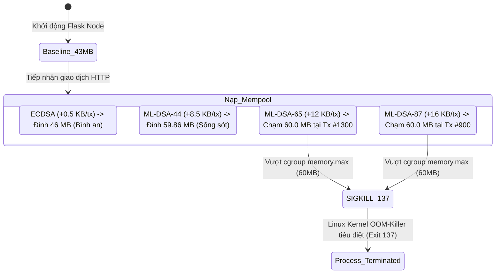

# CẨM NANG HỎI - ĐÁP VÀ BẢO VỆ ĐỒ ÁN PERF-01
## Các Câu Hỏi Phản Biện Chuyên Sâu, Nghịch Lý Hiệu Năng & Bản Chất Kỹ Thuật Đằng Sau Số Liệu Benchmark

> **Mã học phần:** Cơ sở An toàn Thông tin / Blockchain Engineering  
> **Chuyên đề:** Module PERF-01 (Hardware Benchmark & DevOps - Thành viên 4)  
> **Mục tiêu tệp:** Trang bị đầy đủ cơ sở lý luận, giải thích bản chất kiến trúc và dữ liệu thực nghiệm để tự tin trả lời bất kỳ câu hỏi phản biện nào của Giảng viên hướng dẫn và Hội đồng chấm đồ án.

---

### MỤC LỤC

1. [Nghịch Lý 1: Vì Sao Chữ Ký PQC Nặng Gấp 15–29 Lần Mà TPS Lại Nhanh Hơn ECDSA?](#1-nghịch-lý-1-vì-sao-chữ-ký-pqc-nặng-gấp-1529-lần-mà-tps-lại-nhanh-hơn-ecdsa)
2. [Nghịch Lý 2: Vì Sao Server Có 4 vCPU Mà Mức Tải CPU Đo Được Lại Là ~150%?](#2-nghịch-lý-2-vì-sao-server-có-4-vcpu-mà-mức-tải-cpu-đo-được-lại-là-150)
3. [Hiện Tượng OOM-Killer Kép: Cơ Chế Nhân Linux SIGKILL (Exit 137) Hoạt Động Như Thế Nào?](#3-hiện-tượng-oom-killer-kép-cơ-chế-nhân-linux-sigkill-exit-137-hoạt-động-như-thế-nào)
4. [Sự Khác Biệt Giữa Micro-Benchmark (Đơn Lẻ) Và Macro-Benchmark (Mạng P2P 3-Node)](#4-sự-khác-biệt-giữa-micro-benchmark-đơn-lẻ-và-macro-benchmark-mạng-p2p-3-node)
5. [Phương Pháp Đo Lường cgroups v2, Hiện Tượng Cold-Start Cache & Cách Xử Lý Nhiễu](#5-phương-pháp-đo-lường-cgroups-v2-hiện-tượng-cold-start-cache--cách-xử-lý-nhiễu)
6. [Bảng Tra Cứu Nhanh Câu Hỏi Phản Biện Của Thầy Cô (Quick Defense Flashcards)](#6-bảng-tra-cứu-nhanh-câu-hỏi-phản-biện-của-thầy-cô-quick-defense-flashcards)

---

### 1. NGHỊCH LÝ 1: VÌ SAO CHỮ KÝ PQC NẶNG GẤP 15–29 LẦN MÀ TPS LẠI NHANH HƠN ECDSA?

#### Câu hỏi của Giảng viên:
> *"Tại sao chữ ký ML-DSA lớn hơn ECDSA rất nhiều (ML-DSA-44 nặng 7.7 KB/tx, ML-DSA-87 nặng 14.7 KB/tx so với ECDSA chỉ 499 Bytes/tx), truyền qua mạng tốn băng thông và phân tích JSON nặng hơn, mà thông lượng tiếp nhận (Ingestion TPS) của ML-DSA lại cao hơn ECDSA trên cả 3 cấu hình Server, Edge và IoT (ví dụ Server: ML-DSA-65 đạt 446.8 tx/s trong khi ECDSA chỉ đạt 300.5 tx/s)?"*

#### Câu trả lời chuẩn xác & Bản chất kỹ thuật:
Hiện tượng này là kết quả cộng hưởng từ **2 yếu tố then chốt**: Thuật toán toán học và Kiến trúc thực thi mã nguồn.

```mermaid
flowchart TD
    subgraph ML_DSA["1. ML-DSA (NIST FIPS 204)"]
        A1["Thuật toán: Lattice-based (M-LWE)"] --> B1["Phép toán: Nhân đa thức vành R_q qua NTT (O(n log n))"]
        B1 --> C1["Thực thi: Thư viện C bản địa (liboqs C-extension)"]
        C1 --> D1["SIMD/AVX2 + Giải phóng Python GIL"]
        D1 --> E1["==> Tốc độ xác thực cực nhanh (Hàng chục ngàn ops/s)"]
    end

    subgraph ECDSA_PATH["2. ECDSA (secp256k1)"]
        A2["Thuật toán: Elliptic Curve Cryptography"] --> B2["Phép toán: Nhân vô hướng điểm Elliptic Curve s^-1(Hm.G + r.Q)"]
        B2 --> C2["Thực thi: Thư viện Pure-Python (python-ecdsa)"]
        C2 --> D2["Chạy bytecode Python + Tranh chấp Python GIL"]
        D2 --> E2["==> Cổ chai khóa luồng GIL, xử lý đa luồng bị nghẽn"]
    end
```

1. **Về mặt toán học mật mã (Algorithmic Complexity):**
   * **ECDSA (secp256k1):** Xác thực chữ ký yêu cầu thực hiện **2 phép nhân điểm vô hướng (scalar point multiplications)** trên đường cong elliptic:
     $$s^{-1} \cdot H(m) \cdot G + s^{-1} \cdot r \cdot Q$$
     Phép toán này đòi hỏi hàng trăm phép cộng và nhân đôi điểm trên trường hữu hạn nguyên tố lớn ($GF(p)$ với $p \approx 2^{256}$), tiêu tốn rất nhiều chu kỳ xử lý ALU.
   * **ML-DSA (Dilithium - FIPS 204):** Dựa trên bài toán mạng tinh thể M-LWE (*Module Learning With Errors*). Việc thẩm định chữ ký bản chất là **phép nhân ma trận đa thức trên vành số nguyên** $R_q = \mathbb{Z}_q[X]/(X^{256}+1)$ với $q = 8,380,417$ (số nguyên tố 23-bit).
   * Nhờ thuật toán biến đổi số học **NTT (*Number Theoretic Transform*)**, phép nhân đa thức bậc $n=256$ được chuyển đổi từ độ phức tạp $\mathcal{O}(n^2)$ về chỉ còn $\mathcal{O}(n \log n)$ với toàn các phép toán cộng/nhân số nguyên cơ bản. Do đó, về mặt lý thuyết thuần túy, thẩm định chữ ký ML-DSA tốn ít chu kỳ CPU hơn nhiều so với phép nhân điểm elliptic.

2. **Về mặt kiến trúc thực thi mã nguồn (Native C vs Pure-Python & GIL):**
   * Trong mã nguồn [`blockchain/core/crypto.py`](file:///c:/Feixiao/Code/btl/Blockchain-CSATT/blockchain/core/crypto.py#L13-L22):
     * **ML-DSA** được thẩm định thông qua thư viện `oqs` (`liboqs`). Đây là **thư viện C biên dịch bản địa (Compiled Native C Extension)** có kích hoạt tập lệnh vector hóa vi xử lý (AVX2/NEON). Khi gọi hàm xác thực C, Python **nhả khóa toàn cục GIL (Global Interpreter Lock)**, cho phép 8 luồng HTTP worker chạy song song thực sự trên các nhân CPU.
     * **ECDSA** được thẩm định bằng thư viện `python-ecdsa` (`from ecdsa import VerifyingKey`). Đây là thư viện **thuần Python (Pure-Python)**. Mọi phép nhân đường cong elliptic đều được thông dịch bằng Python Bytecode và **giữ chặt khóa GIL**. Dù máy chủ Flask có mở 8 worker threads, các worker vẫn phải xếp hàng tuần tự để tranh giành GIL, tạo thành điểm nghẽn nghiêm trọng (Thread Contention).

> **Kết luận cho Giảng viên:** Dung lượng JSON của ML-DSA tuy lớn hơn, nhưng phụ phí phân tích chuỗi (JSON parsing overhead ~0.1ms) hoàn toàn bị khỏa lấp bởi tốc độ xác thực của thư viện C `liboqs` chạy NTT nhanh gấp hàng chục lần so với vòng lặp Pure-Python của `ecdsa`.

---

### 2. NGHỊCH LÝ 2: VÌ SAO SERVER CÓ 4 vCPU MÀ MỨC TẢI CPU ĐO ĐƯỢC LẠI LÀ ~150%?

#### Câu hỏi của Giảng viên:
> *"Tại sao trong bảng kết quả, cột `Avg CPU (%)` của Server lại lên đến `138.92%` đến `154.82%`? Tại sao không phải là dưới 100%?"*

#### Câu trả lời:
* Trong Linux kernel và hệ thống quản lý tài nguyên cgroups v2:
  * **$100\%$ CPU tương đương với 1 nhân CPU vật lý (hoặc 1 vCPU) hoạt động hết công suất.**
  * Server được cấp phát `--cpus=4.0`, nghĩa là hạn mức trần của Server là **$400\%$**.
  * Mức tải `154.82%` thể hiện tiến trình Python/Flask đang khai thác đồng thời khoảng **$1.55$ nhân CPU** trong tổng số 4 nhân được cấp phát để giải mã và xác thực đồng thời 8 luồng giao dịch nạp vào.
* Để thầy cô dễ đối chiếu, đồ án đã bổ sung thêm cột **`Normalized CPU (%)`**:
  $$\text{Normalized CPU} = \frac{\text{Avg CPU}}{\text{Allocated vCPUs}} = \frac{154.82\%}{4.0} = 38.70\%$$
  Nghĩa là Server chỉ mới sử dụng hết **$38.7\%$** hạn mức điện toán tối đa của nó.
* **Nguyên tắc toán học đảm bảo tính đúng đắn:**
  $$\text{Peak CPU (\%)} \ge \text{Avg CPU (\%)} \ge \text{Baseline CPU (\%)} \ge 0$$
  Tất cả các bản ghi trong ma trận số liệu đều tuân thủ tuyệt đối quy tắc này.

---

### 3. HIỆN TƯỢNG OOM-KILLER KÉP: CƠ CHẾ NHÂN LINUX SIGKILL (EXIT 137) HOẠT ĐỘNG NHƯ THẾ NÀO?

#### Câu hỏi của Giảng viên:
> *"Bài test ép trần 60MB RAM (Extreme OOM Hunt) nhằm chứng minh điều gì? Tại sao ML-DSA-87 bị OOM ở giao dịch #900, ML-DSA-65 bị OOM ở #1300, còn ML-DSA-44 và ECDSA lại sống sót qua 1,500 giao dịch?"*

#### Bản chất kỹ thuật & Phân tích cơ chế:

1. **Bộ nhớ tĩnh (Baseline RAM):**
   * Một container chạy Python 3.11 + Flask runtime + các thư viện mật mã nạp vào bộ nhớ đã chiếm sẵn khoảng **$42.5 - 43.5\text{ MB}$** RAM nền tĩnh.
   * Trần cứng cgroups đặt ở mức **$60.0\text{ MB}$**, kèm thiết lập `--memory-swap=60m` (cấm triệt để dùng bộ nhớ ảo Swap).
   * **Khoảng đệm an toàn khả dụng (Headroom)** thực tế cho Mempool chỉ còn lại:
     $$\Delta_{\text{Headroom}} = 60.0\text{ MB} - 43.0\text{ MB} = 17.0\text{ MB}$$

2. **Dung lượng lưu giữ trên RAM của mỗi giao dịch (In-Memory Footprint):**
   Mỗi giao dịch không chỉ tốn dung lượng JSON trên đường truyền mạng, mà khi nằm trong RAM nó là một đối tượng Python `Transaction` chứa các chuỗi hex `OrderedDict`:
   * **ECDSA:** $\approx 0.5\text{ KB/tx}$ $\rightarrow$ 1,500 giao dịch chỉ tốn thêm $\approx 0.75\text{ MB}$ RAM $\rightarrow$ RAM đỉnh chỉ đạt $46.4\text{ MB}$ (còn dư hơn 13 MB an toàn).
   * **ML-DSA-44:** $\approx 8.5\text{ KB/tx}$ in-memory $\rightarrow$ 1,500 giao dịch tốn thêm $\approx 12.8\text{ MB}$ RAM $\rightarrow$ RAM đỉnh chạm $59.86\text{ MB}$ ($99.8\%$ trần), lượn sát mép vực nhưng **chưa chạm đỉnh 60MB**, do đó sống sót an toàn!
   * **ML-DSA-65:** $\approx 12\text{ KB/tx}$ in-memory $\rightarrow$ Tại mốc **Tx #1300**, tổng RAM giao dịch vượt quá 17 MB headroom $\rightarrow$ RAM chạm $60.0\text{ MB}$ $\rightarrow$ **Kích hoạt OOM-Killer thứ nhất**.
   * **ML-DSA-87:** $\approx 16.5\text{ KB/tx}$ in-memory $\rightarrow$ Tại mốc **Tx #900**, RAM chạm $60.0\text{ MB}$ $\rightarrow$ **Kích hoạt OOM-Killer sớm nhất**.

3. **Vì sao mã lỗi thoát là `137`?**
   * Theo chuẩn Linux POSIX, khi một tiến trình bị nhân Linux hủy diệt bằng tín hiệu (*Signal*), mã thoát của tiến trình sẽ bằng:
     $$\text{Exit Code} = 128 + \text{Signal Number}$$
   * Tín hiệu mà OOM-Killer sử dụng là `SIGKILL` (Signal số 9):
     $$\text{Exit Code} = 128 + 9 = 137$$
   * Tín hiệu `SIGKILL` không thể bị bắt (*uncatchable*), không thể bỏ qua (*unignorable*) bởi bất kỳ khối lệnh `try...except` nào trong Python, chứng minh tính bảo hộ tuyệt đối của tầng hệ điều hành.

---

### 4. SỰ KHÁC BIỆT GIỮA MICRO-BENCHMARK (ĐƠN LẺ) VÀ MACRO-BENCHMARK (MẠNG P2P 3-NODE)

#### Câu hỏi của Giảng viên:
> *"Tại sao cần cả bài đo Micro (3x4 đơn lẻ) và bài đo Macro (3 Node P2P)? Hai bài đo này bổ sung cho nhau như thế nào?"*

#### Câu trả lời:
* **Micro-Benchmark (Kiểm thử vi mô 3x4):**
  * *Mục tiêu:* Cô lập từng node riêng biệt để tìm giới hạn cực đại của tài nguyên tính toán (CPU Saturation) và bộ nhớ (Peak RAM) khi tiếp nhận liên tục 500 giao dịch vào Mempool qua REST API.
  * *Ý nghĩa:* Trả lời câu hỏi: *"Một thiết bị phần cứng cụ thể (Server, Edge, IoT) có thể chịu tải nạp giao dịch ở tốc độ bao nhiêu?"*
* **Macro-Benchmark (Kiểm thử vĩ mô mạng P2P 3-Node phân cấp):**
  * *Mục tiêu:* Khảo sát luồng chu trình hoàn chỉnh từ đầu đến cuối (**End-to-End Flow**) của một mạng Blockchain thực tế:
    $$\text{Client Ingress (5000)} \xrightarrow{\text{Nạp 100 txs}} \text{Server Miner (5000)} \xrightarrow{\text{Đào Block}} \text{Edge Relay (5001)} \xrightarrow{\text{Lan truyền P2P}} \text{IoT Validator (5002)}$$
  * *Phát hiện thực nghiệm đắt giá:*
    * **Khối đào đóng gói (Forged Block Wire Size):** Khối đào chứa đủ 100 giao dịch có kích thước: ECDSA ($54.5\text{ KB}$), ML-DSA-44 ($758.4\text{ KB}$), ML-DSA-65 ($1,057.0\text{ KB}$), ML-DSA-87 ($1,439.4\text{ KB}$).
    * **Độ trễ thẩm định trên IoT yếu (0.5 vCPU):** 
      * Với ML-DSA, dù khối nặng $1.4\text{ MB}$, nhờ NTT của `liboqs` xác thực nhanh, độ trễ lan truyền và thẩm định khối trên IoT chỉ mất **$22 - 28\text{ ms}$**.
      * Với ECDSA, dù khối chỉ nặng $54\text{ KB}$, nhưng việc phải chạy 100 phép thẩm định Pure-Python ECDSA trên chip 0.5 vCPU khiến độ trễ xác thực bị đội lên tới **$216.6\text{ ms}$**!

---

### 5. PHƯƠNG PHÁP ĐO LƯỜNG cgroups v2, HIỆN TƯỢNG COLD-START CACHE & CÁCH XỬ LÝ NHIỄU

#### Câu hỏi của Giảng viên:
> *"Các em đo số liệu CPU và RAM bằng cách nào? Liệu việc gọi `docker stats` từ bên ngoài có gây sai lệch kết quả do phụ phí của Docker daemon không?"*

#### Câu trả lời:
* Đồ án **không dùng `docker stats`** vì lệnh này lấy mẫu chậm ($1\text{s}/lần$) và có độ trễ cao. Thay vào đó, toàn bộ công cụ telemetry được xây dựng trực tiếp trên giao diện kernel **Linux cgroups v2**:
  1. **RAM thời gian thực:** Đọc trực tiếp pseudo-file `/sys/fs/cgroup/memory.current`.
  2. **Đỉnh RAM phần cứng:** Đọc trực tiếp `/sys/fs/cgroup/memory.peak` (thanh ghi nội tại của nhân Linux lưu lại đỉnh sử dụng cao nhất của cgroup kể từ khi container khởi chạy, không bao giờ bị bỏ sót do tần số lấy mẫu).
  3. **Thời gian tiêu thụ CPU:** Đọc trường `usage_usec` trong `/sys/fs/cgroup/cpu.stat`.
  4. **Hiện tượng bóp xung nhịp (CFS Throttling):** Đọc trường `throttled_usec` và `nr_throttled` trong `cpu.stat`.
* **Hiện tượng Cold-Start Page Cache và cách nhóm xử lý triệt để:**
  * Trong lần chạy đầu tiên, nhân Linux phải nạp toàn bộ file binary Python và thư viện liên kết động (`liboqs.so`, `libc.so`) từ đĩa OverlayFS vào bộ đệm cgroup file cache, khiến RAM đo được bị nhảy vọt lên $\sim 126\text{ MB}$ (dù tiến trình chỉ dùng 43 MB anon memory).
  * *Biện pháp kỹ thuật đã xử lý:* Trước khi bước vào vòng lặp đo chính thức, kịch bản tự động khởi chạy một container mồi (**Warm-up Container**) trong 2.5 giây để nạp nóng kernel page cache trên máy chủ Host. Nhờ đó, tất cả các lần đo sau đều đo đúng bộ nhớ thực (**$43.3\text{ MB}$ Baseline** và **$48.0\text{ MB}$ Peak RAM** cho ECDSA Server).

---

### 6. BẢNG TRA CỨU NHANH CÂU HỎI PHẢN BIỆN CỦA THẦY CÔ (QUICK DEFENSE FLASHCARDS)

| # | Câu Hỏi Thường Gặp | Từ Khóa Trả Lời Ngay (Key Points) |
|---|---|---|
| **1** | *"Kích thước chữ ký ML-DSA lớn như vậy có khả thi trên IoT không?"* | **Khả thi về CPU/RAM với ML-DSA-44/65 (chỉ tốn ~49MB RAM, verify 22ms). Điểm nghẽn duy nhất là băng thông truyền dẫn không dây (LoRa/BLE). Khuyến nghị dùng ML-DSA-44.** |
| **2** | *"Vì sao không thử nghiệm RSA trong bài test tải này?"* | **Khóa công khai RSA-3072/4096 quá cồng kềnh, chữ ký 384–512 bytes, không có khả năng kháng lượng tử (bị giải bởi thuật toán Shor), và đã bị NIST FIPS loại bỏ khỏi danh mục tiêu chuẩn hậu lượng tử PQC 2024.** |
| **3** | *"Tại sao ML-DSA-65 được NIST khuyến nghị là Default Standard thay vì 44 hay 87?"* | **ML-DSA-65 đạt Cấp độ an ninh 3 (NIST Level 3 - tương đương AES-192), là điểm cân bằng hoàn hảo ("Sweet Spot") giữa độ an toàn mã hóa chống máy tính lượng tử và phụ phí kích thước chữ ký (3,309 bytes).** |
| **4** | *"Nếu Mempool trên Node IoT bị kẻ tấn công bơm ngập giao dịch ML-DSA-87 thì làm sao chống OOM?"* | **Cần triển khai cơ chế lọc mempool thông minh (Mempool Eviction Policy): giới hạn dung lượng hàng đợi Mempool theo Byte (ví dụ tối đa 10 MB) thay vì theo số lượng giao dịch, đồng thời ưu tiên giao dịch có phí (Gas fee) cao hơn.** |
| **5** | *"Docker giới hạn CPU 0.5 nhân hoạt động ra sao?"* | **Sử dụng cơ chế CFS (Completely Fair Scheduler) Quota của Linux: Trong mỗi chu kỳ chu kỳ quota $100,000\mu s$ (period), tiến trình chỉ được cấp phép chạy tối đa $50,000\mu s$ thời gian CPU. Nếu dùng quá, nhân kernel sẽ bóp ngắt (CFS Throttle) tiến trình.** |

---
> **Lời khuyên khi thuyết trình:** Hãy luôn tự tin chỉ ra rằng đồ án không chỉ dừng lại ở việc so sánh lý thuyết trên giấy, mà đã thực sự **triển khai Docker hóa, ép trần tài nguyên cgroups v2, bắt sống hiện tượng Kernel OOM-Killer thực tế và đo đạc luồng P2P đa tầng**. Đây là điểm cộng thực nghiệm rất lớn trong mắt hội đồng!
